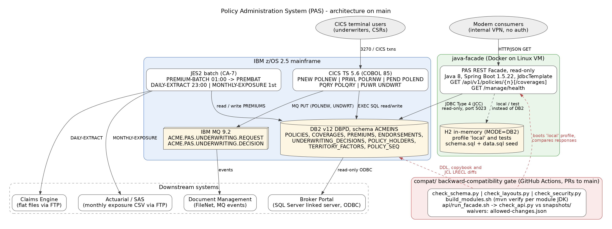

# Policy Administration System (PAS)

## Overview

The Policy Administration System is the **core insurance platform** for Acme Insurance, managing all policy lifecycle operations. Originally built in **1998** on IBM mainframe technology, it remains the system of record for all insurance policies.

**Maturity Level:** 0 (Legacy)

## Architecture

Full description and diagram: [docs/architecture.md](docs/architecture.md). The diagram source is [docs/diagrams/architecture.dot](docs/diagrams/architecture.dot) (Graphviz; re-render with `docs/diagrams/render.sh`).



### Core Platform
- **Language:** COBOL 85
- **Runtime:** IBM z/OS 2.5, CICS Transaction Server 5.6
- **Database:** IBM DB2 v12 for z/OS
- **Messaging:** IBM MQ Series 9.2
- **Batch:** z/OS JES2, CA-7 job scheduling

### REST Facade (Added 2022)
- **Language:** Java 8
- **Framework:** Spring Boot 1.5.22
- **Purpose:** Read-only REST API for modern system integration
- **Deployment:** Docker container on Linux VM (not on z/OS)
- **Data access:** Spring `JdbcTemplate` over the IBM DB2 JCC Type 4 driver

### Local Development Profile (Added 2026)
- `java -jar java-facade/target/pas-facade-1.0.0.jar --spring.profiles.active=local` runs the facade on an in-memory H2 database (DB2 mode) built from `schema.sql` and seeded from `data.sql` (policies `POL-00000001` to `POL-00000003`)
- The H2 console is enabled at `/h2-console` in this profile only
- The tests (`mvn verify` in `java-facade/`) use the same H2 setup, so no DB2 connection is needed

### Backward-Compatibility Gate (Added 2026)
- `compat/` holds the checks that every pull request to `main` must pass during the modernization (epic AB-516): DB schema, COBOL copybook and JCL record layouts, security non-regression, Maven build and tests, and the REST API contract against recorded snapshots
- Runs in GitHub Actions (`.github/workflows/compat-gate.yml`); run it locally with `make compat`
- Approved breaking changes are listed in `compat/allowed-changes.json`; see [compat/README.md](compat/README.md)

## CICS Transactions

| Transaction | Program | Description |
|-------------|---------|-------------|
| PNEW | POLNEW | Create new policy |
| PRWL | POLRNW | Policy renewal |
| PEND | POLEND | Endorsement processing |
| PQRY | POLQRY | Policy inquiry (read-only) |
| PUWR | UNDWRT | Underwriting decision |

## Batch Jobs

| JCL Job | Schedule | Description |
|---------|----------|-------------|
| DAILY-EXTRACT | Daily 23:00 | Extract policy data for Claims/Broker |
| MONTHLY-EXPOSURE | 1st of month | Exposure data for actuarial models |
| PREMIUM-BATCH | Daily 01:00 | Recalculate premiums (PREMBAT program) |

## DB2 Tables

- `POLICIES` - Policy master (header)
- `COVERAGES` - Coverage/LOB detail
- `PREMIUMS` - Premium calculations
- `ENDORSEMENTS` - Policy changes
- `UNDERWRITING_DECISIONS` - UW decision audit trail
- `POLICY_HOLDERS` - Customer master
- `TERRITORY_FACTORS` - Territory rating factors (reference)
- `POLICY_SEQ` - Sequence for new policy numbers

## REST API Endpoints (Facade)

```
GET /api/v1/policies/{policyNumber}            - Policy details (JSON)
GET /api/v1/policies/{policyNumber}/coverages   - Coverage list (JSON)
GET /manage/health                              - Health check
```

> **WARNING:** The REST facade is **read-only**. All policy mutations must go through CICS transactions on the mainframe.

## Integration Points

- **Claims Engine:** Nightly flat-file extract (FTP) via DAILY-EXTRACT.jcl
- **Actuarial Models:** Monthly exposure CSV via MONTHLY-EXPOSURE.jcl
- **Broker Portal:** SQL Server linked server to DB2 (read-only ODBC)
- **Document Management:** IBM MQ events trigger document creation in FileNet
- **Underwriting queues:** POLNEW puts referrals on `ACME.PAS.UNDERWRITING.REQUEST`; UNDWRT puts decisions on `ACME.PAS.UNDERWRITING.DECISION`

## Known Limitations

1. **No real-time API for writes** - All mutations require CICS terminal or MQ message
2. **Hardcoded rating factors** - Base rates per policy type and the 3.5% tax rate are hardcoded in PREMBAT; territory factors come from `TERRITORY_FACTORS`, but PREMBAT does not apply them yet (it stores factor 1.0000)
3. **Leap year bug** - POLRNW renewal date calculation does not handle leap years correctly
4. **No state-specific rate caps** - Using flat 15% rate increase cap instead of state-specific regulatory limits
5. **Java facade has no authentication** - Relies on network segmentation (internal VPN only)
6. **Single-threaded batch** - PREMBAT processes policies sequentially; takes ~4 hours for full book
7. **FTP file transfer** - No encryption on daily extract files (regulatory risk)

## Source Control and CI

- **Repository:** this GitHub repository (`COG-GTM/insurance-policy-admin`) holds the COBOL programs, copybooks, JCL, DB2 DDL and the Java facade
- **CI:** the PAS backward-compatibility gate (GitHub Actions) runs on every pull request to `main`
- **No CD pipeline** - Mainframe compilation and facade deployment are still manual

## Team Contacts

- **Mainframe Team:** mainframe-ops@acme.com
- **DBA Team:** db2-admin@acme.com
- **Java Facade:** t.nguyen@acme.com
