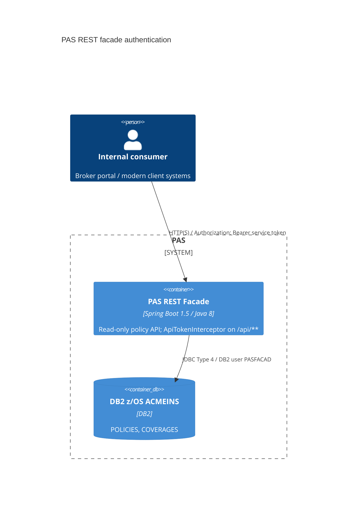

# 0001. Bearer-token authentication and trimmed policy response on the PAS REST facade

- **Status:** Proposed
- **Date:** 2026-10-16
- **ARB ticket:** TO BE CREATED
- **Authors:** Devin (code-scan remediation, finding sfind-d4a9f1b3942a43be9bd0291bb46b390a)
- **Owning team:** Java Facade (t.nguyen@acme.com)
- **Related ADRs:** none

## Context

The read-only PAS REST facade (`java-facade`, Spring Boot 1.5 / Java 8) served
`GET /api/v1/policies/{n}` and `/{n}/coverages` with no authentication, relying on
"internal VPN only" network segmentation. Policy numbers are sequential
(`POL-00000001`, ...), so any caller that could reach the port could enumerate the
whole book. The policy response also serialized internal underwriting/audit columns
(`UW_STATUS`, `RISK_SCORE`, `UPDATED_BY`, `AGENT_CODE`, `WEB_INDICATOR`, `API_FLAG`).
A security code scan flagged this as mass enumeration of policy and internal UW data.

ARB triggers: T6 (authentication added to an existing endpoint), T4 (breaking change to
the `/api/v1/policies/{n}` response contract — six fields removed; unauthenticated
callers now get 401).

## Decision

We will require `Authorization: Bearer <token>` on every `/api/**` request, validated
in-process by a Spring MVC `HandlerInterceptor` against shared service tokens supplied
via the `PAS_API_TOKENS` environment variable (comma-separated to allow rotation),
failing closed when none are configured; and we will return a `PolicyResponse` DTO that
omits the six internal fields. `/manage/health` stays unauthenticated for probes. This is
an interim control; OAuth2 / mTLS at the gateway remains the target state.

## Alternatives considered

| Alternative | Pros | Cons | Why rejected |
| --- | --- | --- | --- |
| Do nothing (VPN only) | No consumer change | Any VPN host can bulk-exfiltrate every policy and UW data | Unacceptable data-exposure risk |
| Spring Security + OAuth2 resource server now | Standard, per-client identity, scopes | New dependency (Boot 1.5 security auto-config also changes actuator behaviour); needs an IdP/issuer decision and client onboarding | Larger change needing IdP choice; kept as Phase-2 target |
| mTLS at the gateway only | No app change | Depends on gateway infra not described in this repo; no defence if facade port is reachable directly | Not implementable from this repo; complementary, not a replacement |

## Architecture

## Non-functional requirements

| NFR | Target | How met |
| --- | --- | --- |
| Availability SLO | Unchanged — TBD by owner | No new runtime dependency; check is in-process |
| p95 latency | Unchanged (sub-ms added) | Constant-time byte compare per configured token |
| RPO / RTO | N/A — no new data store | |
| Peak load | Unchanged | |
| Scaling model | Unchanged (stateless) | Tokens read from config at startup |
| Data retention | N/A | |

## Security & compliance

- **Data classification:** Policy data is confidential business/customer data; UW fields are internal and no longer exposed.
- **Encryption at rest:** N/A — unchanged.
- **Encryption in transit:** Unchanged; bearer tokens must only travel over TLS/VPN (gateway TLS is an open question).
- **AuthN / AuthZ:** Shared service bearer token(s); no per-client identity or per-policy authorization yet. Policy numbers are not treated as authorization.
- **Secrets:** `PAS_API_TOKENS` env var from the deployment secret store; no default value in code or properties; fail closed if unset.
- **Audit logging:** Presented tokens are never logged; per-client audit requires OAuth2 (follow-up).
- **Data residency / regions:** Unchanged.
- **Policy sections satisfied:** No new infrastructure or dependencies.
- **Threats considered:** Sequential-ID enumeration (blocked without token); existence oracle (unauthenticated unknown IDs return 401, not 404); timing attacks on token compare (`MessageDigest.isEqual`); path-normalisation bypass (interceptor uses Spring MVC's own lookup path).

## Cost

| Item | Assumption | Monthly estimate |
| --- | --- | --- |
| Code change only | No new infra | $0 |
| **Total** | | $0 |

## Operations

- **On-call rotation:** Java Facade team (unchanged).
- **Runbook:** Set/rotate `PAS_API_TOKENS` (add new token, migrate consumers, remove old token).
- **Dashboards / alarms:** TBD — owner to add 401-rate alarm.
- **Rollback plan:** Revert the PR; no data migration.
- **Migration / cut-over plan:** Issue tokens to consumers and configure `PAS_API_TOKENS` before deploying; consumers reading the six removed fields must source them elsewhere.

## Policy exceptions requested

| Rule | Resource | Justification | Compensating control | Expiry |
| --- | --- | --- | --- | --- |
| none | | | | |

## Consequences

- Positive: Closes unauthenticated enumeration and internal UW data exposure.
- Negative / risks: Breaking for existing consumers until they send a token; shared token has no per-client attribution.
- Follow-ups: OAuth2 resource server / gateway mTLS (Phase 2); per-client audit logging; consider non-sequential public identifiers.

## Open questions

- Which consumers call the facade today, and do any rely on `riskScore`/`uwStatus`/`agentCode`/`updatedBy`/flags?
- Where is `PAS_API_TOKENS` stored and rotated in the deployment environment?
- Is TLS terminated in front of the facade?
