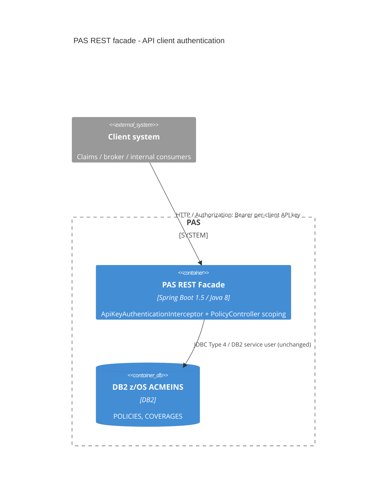

# 0001. API client authentication and policy scoping for the PAS REST facade

- **Status:** Proposed
- **Date:** 2026-10-20
- **ARB ticket:** TO BE CREATED
- **Authors:** Devin (security remediation, code scan finding sfind-74052438772f4fd49a13201b98f23e6b)
- **Owning team:** Java Facade (t.nguyen@acme.com)
- **Related ADRs:** none

## Context

The PAS REST facade (`java-facade`) exposes `GET /api/v1/policies/{policyNumber}` and
`GET /api/v1/policies/{policyNumber}/coverages`. These endpoints had no authentication and no
authorization; they relied only on internal network segmentation. Policy numbers are generated from
a sequential DB2 sequence (`POLICY_SEQ`, see `cobol/programs/POLNEW.cbl`), so anyone who can reach
port 8080 can enumerate every policy's premium, deductible, limits, policyholder ID, agent/branch,
underwriting status and risk score (IDOR, OWASP A01:2021 Broken Access Control, CWE-639 / CWE-306).

Constraints: Spring Boot 1.5 / Java 8 (z/OS Java runtime), read-only facade, no new third-party
dependencies, no change to the JSON response contract, DB schema or COBOL layouts.

ARB triggers: T6 (authentication / authorization boundary change on an existing internal API).
Not triggered: T1, T2, T3, T4 (response contract unchanged for authenticated, entitled callers),
T5, T7, T8, T9.

## Decision

We will require every caller of `/api/**` to present a per-client API key
(`Authorization: Bearer <key>`), validated by a Spring MVC `HandlerInterceptor` against SHA-256
hashes supplied through external configuration (`pas.security.clients[n].*`), and we will authorize
each policy read against the client's configured branch codes and the existing `API_FLAG` column.
Unauthenticated requests get 401; policies outside the client's scope (or with `API_FLAG != 'Y'`)
get 404, indistinguishable from not found. Malformed policy numbers get 400. With no clients
configured the API fails closed.

## Alternatives considered

| Alternative | Pros | Cons | Why rejected |
| --- | --- | --- | --- |
| Do nothing (network segmentation only) | No consumer change | Any internal host / VPN user / SSRF foothold can enumerate the whole book | Leaves a confirmed IDOR open |
| OAuth2 client-credentials via Spring Security OAuth2 | Standard, short-lived tokens | Needs new dependencies and an IdP integration; Boot 1.5 OAuth2 stack is end-of-life | Too large for a remediation; recommended as the follow-up (same `Authorization: Bearer` header, so clients migrate transparently) |
| mTLS between client systems and the facade | Strong client identity | Needs PKI/infra changes outside this repo | Infra work; can be layered later |
| `spring-boot-starter-security` with HTTP Basic | Framework-standard | New dependency; also changes actuator/default security behaviour | Broader blast radius than needed |

## Architecture

## Non-functional requirements

| NFR | Target | How met |
| --- | --- | --- |
| Availability SLO | TBD — owner to confirm before ARB | Unchanged; no new runtime dependency |
| p95 latency | TBD — owner to confirm before ARB | One in-memory SHA-256 + hash comparison per request |
| RPO / RTO | N/A — no new data store | |
| Peak load | TBD — owner to confirm before ARB | |
| Scaling model | Unchanged (stateless) | Client registry is static config |
| Data retention | N/A — no new data stored | |

## Security & compliance

- **Data classification:** Policy and policyholder data (confidential, contains PII identifiers). Unchanged.
- **Encryption at rest:** N/A — no new storage.
- **Encryption in transit:** Unchanged; TLS termination expected at the gateway/load balancer (TBD — owner to confirm).
- **AuthN / AuthZ:** Per-client API key (Bearer). Authorization by branch code entitlement (`*` = full book, explicit opt-in) plus `API_FLAG = 'Y'`.
- **Secrets:** Only SHA-256 hashes of keys are configured, via environment/external config (`PAS_SECURITY_CLIENTS_<n>_KEY_SHA256`). Keys are compared in constant time and never logged.
- **Audit logging:** TBD — follow-up to log client id per request.
- **Data residency / regions:** Unchanged.
- **Policy sections satisfied:** compat gate security non-regression (no hardcoded secrets outside local/test profiles).
- **Threats considered:** enumeration of sequential policy numbers (blocked by authN + scoping), existence oracle (out-of-scope returns 404), timing attacks on key comparison (`MessageDigest.isEqual` over all clients), malformed input (format allow-list `^[A-Z0-9-]{1,12}$`).

## Cost

| Item | Assumption | Monthly estimate |
| --- | --- | --- |
| None | Code-only change, no new infrastructure | $0 |
| **Total** | | $0 |

## Operations

- **On-call rotation:** Java Facade team (TBD — owner to confirm).
- **Runbook:** Issue a key per client system, store the raw key in the client's secret store, configure its SHA-256 and branch codes on the facade, restart.
- **Dashboards / alarms:** TBD — alert on 401 spikes.
- **Rollback plan:** Revert the PR.
- **Migration / cut-over plan:** Provision keys for every existing consumer and configure them before deploying; unconfigured consumers will receive 401.

## Policy exceptions requested

| Rule | Resource | Justification | Compensating control | Expiry |
| --- | --- | --- | --- | --- |
| none | | | | |

## Consequences

- Positive: closes the unauthenticated enumeration path; per-client entitlement model; same header as a future OAuth2 bearer token.
- Negative / risks: breaking change for existing unauthenticated consumers (they need a key); static key rotation requires a config change and restart.
- Follow-ups: OAuth2 client-credentials or mTLS; gateway rate limiting; per-request audit log with client id.

## Open questions

- Inventory of current consumers and their branch entitlements.
- NFR targets and audit-logging requirements.
