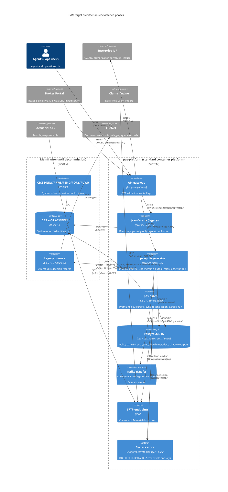

# 0001. PAS target architecture: off COBOL/CICS/DB2 onto Java 21, PostgreSQL and Kafka

- **Status:** Proposed
- **Date:** 2026-10-22
- **ARB ticket:** ARB-TBD — to be created (submission body: [`arb/0001-submission.md`](arb/0001-submission.md))
- **Jira:** AB-518 (epic AB-516 "PAS modernization")
- **Authors:** PAS modernization team
- **Owning team:** PAS modernization team (name and on-call rotation TBD, see [Open questions](#open-questions))
- **Related ADRs:** none (first ADR in this repository)

## Context

The Policy Administration System (PAS) is the system of record for every Acme Insurance policy.
It runs as COBOL 85 on z/OS 2.5: five CICS transactions (`PNEW`/POLNEW, `PRWL`/POLRNW,
`PEND`/POLEND, `PQRY`/POLQRY, `PUWR`/UNDWRT), the PREMBAT batch program and three JCL jobs
(`PREMIUM-BATCH`, `DAILY-EXTRACT`, `MONTHLY-EXPOSURE`) on DB2 v12 for z/OS (schema `ACMEINS`,
`sql/ddl/create-tables.sql`). A read-only Java 8 / Spring Boot 1.5 facade (`java-facade/`) exposes
`GET /api/v1/policies/{policyNumber}` and `/coverages` straight off DB2 with no authentication.

Problems this ADR addresses (from the repository `README.md` and the AB-517 discovery):

| # | Problem | Evidence |
| --- | --- | --- |
| P1 | No API for writes; all mutations need a CICS terminal or a queue message | README "Known limitations" 1 |
| P2 | Rating factors hard-coded in PREMBAT; territory factors never loaded | `cobol/programs/PREMBAT.cbl` |
| P3 | Premium batch is single-threaded and takes ~4 hours for the full book | README limitation 6 |
| P4 | The facade has no authentication or object-level authorization (AB-365) and renewal has an IDOR (AB-364) | `java-facade/`, AB-364, AB-365 |
| P5 | Claims and Actuarial feeds go over plain FTP with no encryption (regulatory risk) | `jcl/DAILY-EXTRACT.jcl` STEP030, `jcl/MONTHLY-EXPOSURE.jcl` STEP020 |
| P6 | Broker Portal reads DB2 directly through a SQL Server linked server (ODBC) | README "Integration points" |
| P7 | Document and underwriting events are fixed-layout `POLICY-RECORD` blobs on CICS queues (`ACME.PAS.UNDERWRITING.REQUEST`, `ACME.PAS.UNDERWRITING.DECISION` via `WRITEQ TD`; `ENDORSEMENT-AUDIT` via `WRITEQ TS`) that FileNet and other consumers parse byte by byte | `POLNEW.cbl`, `UNDWRT.cbl`, `POLEND.cbl` |
| P8 | Regulated PII (date of birth, SSN last 4, tax ID, credit score) stored in clear in `POLICY_HOLDERS` | `sql/ddl/create-tables.sql` |
| P9 | Java facade runtime (Java 8, Spring Boot 1.5) is long out of support; no CI/CD | README "Source control" |

Constraints:

- **Strangler migration, not big bang.** DB2 stays the system of record until the cutover ticket
  (AB-529 data migration, AB-530 cutover). Legacy trees `cobol/`, `jcl/`, `java-facade/` and
  `sql/ddl/` are not edited by the migration (the compat gate in `compat/` guards their contracts).
- **Behavioural parity.** Business rules, rounding and seeded quirks must be reproduced or
  deliberately fixed with a recorded decision in the AB-517 quirk register
  (`docs/modernization/quirk-register.md`, `### Q-NN` ids).
- **Unchanged consumers keep working** through the transition: Claims (VB6 import of fixed-width
  files), Actuarial SAS, Broker Portal, FileNet document creation, and every client of the
  `/api/v1/policies` contract (snapshot in `compat/api/snapshots/policies-v1.json`).

ARB triggers (hand triage against `rules/arb-triggers.md`, see the
[submission](arb/0001-submission.md#arb-triage)): **T1, T2, T4, T5, T6, T7, T8** (T9 not yet
estimated) → `ARB_REQUIRED`.

## Decision

We will replace the PAS mainframe workload with **two deployables in a new `pas-platform/`
Maven build** — one online **policy service** covering inquiry, policy lifecycle (new business,
renewal, endorsement), underwriting and event publication, and one **Spring Batch application**
for premium recalculation, extracts and migration jobs — built on **Java 21 / Spring Boot 3.5**
and run as containers on the standard platform. Policy data moves to **PostgreSQL 16** (schemas
`pas`, `pas_batch`, transitional `pas_shadow`, all managed by Flyway), loaded from DB2 by a bulk
load plus continuous delta sync while DB2 remains the system of record, with reverse sync back to
DB2 for the rollback window after cutover. CICS queue messages are replaced by **Kafka** topics fed
from a **transactional outbox**; the new APIs are **OAuth2 JWT** resource servers with scope checks
and SQL-level object authorization; plain FTP is replaced by **SFTP** with checksums and `.done`
markers. Traffic moves one capability at a time behind **per-capability route flags**, and a
capability only counts as moved when parity is green, the parallel run is clean and its owners have
signed off. The detailed decisions D1–D11 below are binding for every AB-516 child ticket.

| Id | Decision (summary) |
| --- | --- |
| [D1](#d1-service-boundaries) | One policy service + one batch app; shared rating library; no per-transaction services |
| [D2](#d2-runtime-and-build) | Java 21, Spring Boot 3.5.x (pinned patch), Maven multi-module, containers on the standard platform |
| [D3](#d3-target-database) | PostgreSQL 16 |
| [D4](#d4-schema-ownership-and-flyway-rules) | Schemas `pas` / `pas_batch` / `pas_shadow`, Flyway ownership and version ranges |
| [D5](#d5-data-migration-and-coexistence) | Bulk load + delta sync from DB2; DB2 system of record until cutover; `pas_shadow` parallel run; reverse sync for rollback |
| [D6](#d6-messaging) | Kafka (KRaft) + transactional outbox; versioned JSON envelope with `policyVersion`; legacy-format bridge for FileNet |
| [D7](#d7-authentication-and-authorization) | OAuth2 JWT resource server, scopes, entitlement claims, SQL-level object authorization; facade gateway-only until retired |
| [D8](#d8-secure-file-transfer) | SFTP, key auth, pinned host key, SHA-256 checksum + `.done` marker |
| [D9](#d9-strangler-routing-and-definition-of-moved) | Route flags per capability (`legacy` / `new` / `retired`); definition of "moved" |
| [D10](#d10-observability) | Structured JSON logs, Micrometer/Prometheus, probes, correlation ids; never log PII |
| [D11](#d11-behavioural-parity-rules) | BigDecimal money, COBOL truncation rules, quirk register, legacy byte layouts |

---

### D1. Service boundaries

**Context.** The five CICS transactions and PREMBAT all read and write the same aggregate
(a policy with its coverages, premiums, endorsements and underwriting decisions) and share the
same rating rules. POLNEW triggers underwriting; POLRNW and POLEND re-rate; PREMBAT re-rates the
whole book. The data model has foreign keys from every child table to `POLICIES`.

**Decision.** Build **one online service, `pas-policy-service`** (HTTP 8080), covering inquiry,
new business, underwriting, renewal, endorsement, event publication (outbox relay) and admin
endpoints, and **one batch application, `pas-batch`** (HTTP 8081 for probes and the job-operator
API), covering the premium job, the Claims/Actuarial extracts, and the migration, reconciliation
and parallel-run jobs. Shared code lives in libraries, not services: `pas-common` (domain types,
88-level enums, copybook codecs, PII crypto/masking) and `pas-rating` (the rating component used by
both deployables). `pas-parity` is test-scope only. Inside `pas-policy-service` each capability is
its own package (`com.acme.insurance.pas.<area>`) so it can be routed, tested and later extracted
independently.

**Alternatives considered.**

| Alternative | Why rejected |
| --- | --- |
| One microservice per CICS transaction (5+ services) | Every transaction writes the same policy aggregate, so per-transaction services would either share one database (a distributed monolith) or need sagas for what is today one unit of work. Rating would be duplicated or become a synchronous dependency on the hot path. Five deployables, pipelines and on-call surfaces for one team with no independent scaling need. |
| Modular monolith in a single deployable (online + batch together) | The premium job is CPU- and connection-heavy (full book in < 30 min, see NFRs) and would compete with online latency and connection pools; a batch failure or deploy would take the online API down; the two have different scaling (horizontal online vs. partitioned batch workers) and schedules. |
| Rehost COBOL (e.g. COBOL on Linux / emulator) | Keeps the language, skills gap and hard-coded rating; does not address P1–P8; still needs the same data and messaging work. |
| Do nothing | Leaves P1–P9 open, including the unauthenticated facade and plain-FTP regulatory findings. |

**Consequences.** Two deployables to operate. Capability boundaries are enforced by package
structure and route flags rather than network boundaries; a capability can be split out later if
it needs independent scaling. The batch app reaches `pas` through the same Flyway-managed schema
the service owns (D4), so schema changes must be coordinated across both.

### D2. Runtime and build

**Decision.** Java 21 (LTS) and Spring Boot **3.5.x with a pinned patch version** (no ranges), Spring
Batch 5 for batch, Spring Security 6 resource server, Flyway, Micrometer. Maven multi-module build
under `pas-platform/` with the Maven wrapper committed, groupId `com.acme.insurance.pas`, base
package `com.acme.insurance.pas.<area>`. Modules: `pas-common`, `pas-rating`, `pas-parity`,
`pas-policy-service`, `pas-batch`. Each deployable is a non-root container image built in CI and
deployed to the **standard container platform** (under the enterprise approved-infrastructure
policy that is ECS; see [Policy exceptions](#policy-exceptions-requested)). Configuration comes from
environment variables and the platform secrets store, never from committed files. CI runs as
`pas-platform / <job>` checks alongside the existing compat gate.

**Alternatives considered.**

| Alternative | Why rejected |
| --- | --- |
| Upgrade the existing facade in place (Java 8 → 17, Boot 1.5 → 2.7) | Boot 2.7 is already out of OSS support; the facade is read-only and coupled to DB2; it would be a second migration later. |
| Quarkus / Micronaut | Viable, but the organisation's Java estate, the facade team and Spring Batch (needed for chunked, restartable batch) are Spring-based; no requirement (e.g. native startup) justifies the skills split. |
| Java on z/OS (Liberty / JZOS) next to the COBOL | Keeps MIPS cost and the mainframe dependency the epic aims to remove (AB-530 decommission). |
| Keep JCL/CA-7 and only rewrite programs | Batch would still depend on z/OS scheduling and datasets. |

**Consequences.** Boot 3.5 requires Jakarta EE namespaces (no reuse of facade code). Patch upgrades
are routine dependency bumps; a Boot 4 / Java 25 move is a future ADR.

### D3. Target database

**Context.** `ACMEINS` is six business tables, one reference table (`TERRITORY_FACTORS`) and one
sequence (`POLICY_SEQ`), using `CHAR`, `VARCHAR`, `DECIMAL(p,s)`, `DATE`, `TIMESTAMP`, `SMALLINT`.

**Decision.** **PostgreSQL 16**, as the platform's managed PostgreSQL offering (RDS under the
approved-infra policy) with multi-AZ, encryption at rest with a customer-managed key, TLS-only
connections and automated backups with point-in-time recovery. DB2 types map to `CHAR`/`VARCHAR`,
`NUMERIC(p,s)`, `DATE`, `TIMESTAMP` (UTC), `SMALLINT`/`INTEGER`; `POLICY_SEQ` becomes `pas.policy_seq`.
Ordering-sensitive output (extracts) uses `COLLATE "C"` and an explicit `ORDER BY`.

**Alternatives considered.**

| Alternative | Pros | Why rejected |
| --- | --- | --- |
| Db2 LUW | Closest dialect and types; IBM tooling for replication from Db2 z/OS | Licence cost and IBM lock-in remain after the mainframe goes; smaller skills pool; not a managed offering on the standard platform. |
| Oracle | Mature, strong tooling | Licence cost; no existing PAS skills or platform offering; no technical requirement it uniquely meets. |
| Stay on DB2 z/OS, new code over JDBC | No data migration | Keeps the mainframe as a hard dependency, blocks decommission and MIPS savings, and DB2 remains reachable by every legacy consumer. |

**Consequences.** Dialect differences must be handled explicitly and covered by parity tests:
EBCDIC vs. ASCII collation (digits sort after letters in EBCDIC, before them in `"C"`), `CHAR`
blank-padding semantics, `CURRENT TIMESTAMP` precision, DB2 `DATE` arithmetic in COBOL
(e.g. the POLRNW `+10000` leap-day quirk, preserved or fixed per the quirk register). Testcontainers
PostgreSQL 16 is the test database for every integration test (no H2 for new code).

### D4. Schema ownership and Flyway rules

**Decision.**

| Schema | Contents | Migrations live in | Writers |
| --- | --- | --- | --- |
| `pas` | ACMEINS business tables, reference/rating tables, `outbox`, idempotency keys, migration control tables | `pas-platform/pas-policy-service/src/main/resources/db/migration` (the **only** location for `pas` and `pas_shadow` DDL) | Before cutover: **only the DB2 sync job** (D5). After cutover: policy service and batch app. |
| `pas_batch` | Spring Batch metadata, batch-owned run tables | `pas-platform/pas-batch/src/main/resources/db/migration/batch` | `pas-batch` |
| `pas_shadow` | Parallel-run outputs (e.g. `pas_shadow.premiums`) | Same location as `pas` | `pas-batch` parallel-run jobs only |

Rules:

1. `pas-batch` **never migrates `pas`**; it validates that the schema version it needs is present.
   Batch tests that need `pas` tables load the `pas-policy-service` migrations from the test classpath.
2. **Never edit a migration that is merged** to the integration branch or `main`
   (`compat/check_schema.py` fails on edits to applied migrations). Fix forward with a new version.
3. **Version ranges are allocated per ticket** to avoid collisions between parallel work (see
   [Appendix A](#appendix-a-flyway-version-allocation)); gaps are fine; `outOfOrder` stays off.
4. **`pas_shadow` has no foreign keys to `pas`.** Shadow rows are compared, not joined, and must not
   block sync deletes or cutover; `pas_shadow` is dropped at decommission (AB-530).
5. Separate database roles: a migration role (DDL), `pas` runtime role for the service, a batch role,
   a sync role, and a read-only role. Before cutover, production grants give the service and batch
   roles **no write privilege on the business tables of `pas`** — the grant is what enforces "only
   the sync job writes `pas`"; AB-530's cutover runbook flips the grants. Non-production
   environments may enable writes for testing.
6. Destructive DDL (dropping tables/columns, narrowing types) is not used during coexistence; it
   needs the compat gate allowance and a ticket in `compat/allowed-changes.json`.

**Alternatives considered.** One Flyway history per module including `pas` in the batch app
(rejected: two owners of one schema, migration races on deploy); Liquibase (rejected: no advantage
over Flyway for SQL-first migrations, and Flyway is already the Boot default); hibernate
`ddl-auto` (rejected: not reviewable, unsafe in production).

**Consequences.** Every schema change that the batch app needs ships with a policy-service release
first. Tests that pin the applied-migration list must be updated with each new version.

### D5. Data migration and coexistence

**Decision.**

1. **DB2 remains the system of record until cutover** (AB-530). CICS transactions keep writing DB2.
2. **Bulk load** (`pas-batch`, AB-529): initial copy of every `ACMEINS` table into `pas` over the
   DB2 Type 4 JDBC driver with TLS, transforming types and encrypting PII on the way in (D7). Run per
   table in key ranges, restartable.
3. **Delta sync** (`pas-batch`): continuous, pull-based change capture from DB2 using per-table
   watermarks (`LAST_UPDATED`, `PROCESSED_DATE`, `CREATED_TIMESTAMP`, `CALC_DATE`), with children
   of a changed policy re-synced as a set (`COVERAGES` has no timestamp of its own). Upserts are
   idempotent by primary key, so re-running a window is safe. Sync can be paused and resumed and
   reports its lag as a metric.
4. **Reconciliation** (`pas-batch`): scheduled row-count and per-row hash comparison of DB2 vs. `pas`;
   any mismatch alerts and is triaged before a capability can move. Reports never contain decrypted
   PII (use HMAC fingerprints).
5. **Parallel run** (`pas-batch`): the new premium job and extracts run against `pas` and write to
   `pas_shadow` / shadow files; a diff job compares them with the legacy outputs. Differences are
   either fixed or recorded as known differences linked to a quirk-register Q-id.
6. **Before cutover only the sync job writes `pas`** (enforced by grants, D4 rule 5). Write
   capabilities therefore stay on `legacy` until cutover and all flip together, because the
   system of record flips once; read capabilities and extracts can move earlier, reading `pas`,
   provided they check the sync watermark covers their cut-off.
7. **Cutover** (AB-530): freeze CICS write transactions, drain the delta sync to zero lag, run a
   final reconciliation, flip `pas` grants and route flags for all write capabilities and the
   premium job, then start the **reverse sync**.
8. **Reverse sync for rollback**: for the rollback window after cutover, changes written to `pas`
   are replicated back to `ACMEINS` so DB2 stays a warm fallback. Rollback = stop new writers,
   drain reverse sync, reconcile, flip flags back to `legacy`, re-enable the CICS transactions.
   Targets in [NFRs](#non-functional-requirements).

**Alternatives considered.**

| Alternative | Why rejected |
| --- | --- |
| Big-bang migration over one weekend | All capabilities switch with no parallel run; rollback means restoring DB2 and losing post-cutover writes. |
| Dual writes from the application (write DB2 and PostgreSQL) | No atomicity across the two databases; CICS still writes only DB2, so drift is guaranteed. |
| Bidirectional replication during coexistence | Needs conflict resolution for one aggregate edited on both sides; not needed if writes flip together. |
| Log-based CDC from DB2 z/OS (IBM replication tooling) | Lower latency and catches every change, but needs a licensed mainframe product and mainframe-side change lead time. Kept as the upgrade path if reconciliation shows the watermark approach misses changes or lag breaches target. |
| Do nothing (new code reads DB2 directly) | Keeps DB2 on the hot path and blocks decommission. |

**Consequences.** Sync lag is visible to read capabilities that move early; their owners accept the
target lag. COBOL paths that change rows without bumping a timestamp are a known risk: AB-517
discovery lists them and reconciliation is the safety net. The sync needs network access from the
platform to DB2 (`mainframe.acme.local:5023`) with a dedicated, read-only DB2 user, and the reverse
sync needs a write-capable DB2 user for the rollback window only.

### D6. Messaging

**Context.** POLNEW and UNDWRT write the whole 125-byte `POLICY-RECORD` (IBM037 EBCDIC, COMP-3 money)
to queues named `ACME.PAS.UNDERWRITING.REQUEST` / `ACME.PAS.UNDERWRITING.DECISION` with
`EXEC CICS WRITEQ TD` (the code comments call them MQ); POLEND writes the record to the temporary
storage queue `ENDORSEMENT-AUDIT`. FileNet document creation is triggered from these messages.

**Decision.** **Apache Kafka (KRaft mode)** with a **transactional outbox** in `pas`.

- Topics (v1, partition key = `policyNumber`, replication factor 3, `min.insync.replicas=2`):
  `pas.policy.events.v1` (policy lifecycle: created, renewed, endorsed, status/premium changes),
  `pas.underwriting.events.v1` (referral requested, decision recorded),
  `pas.document.requests.v1` (document generation requests for FileNet).
- **Envelope** (JSON, schemas under `pas-platform/events/schemas/v1/`):

  ```json
  {
    "eventId": "3f1c2a9e-7b4d-4f7e-9a51-0c6d2b8e4f10",
    "eventType": "PolicyCreated",
    "schemaVersion": 1,
    "policyNumber": "POL000123456",
    "policyVersion": 3,
    "occurredAt": "2026-10-22T14:05:09.123Z",
    "correlationId": "b7d0c1e2-5a34-4c8f-9e21-6f3a8d9b0c47",
    "data": {}
  }
  ```

  `policyVersion` is the policy row's optimistic-lock version after the change; consumers use it to
  order and to discard stale or duplicate events. `occurredAt` is UTC ISO-8601 with `Z`. Events
  carry identifiers, not PII: no policyholder name, DOB, SSN, tax ID or credit score in `data`.
- **Outbox**: the business write and the outbox row commit in one database transaction (the writer
  requires an existing transaction). A single active relay (advisory lock) publishes **in order per
  policy**, one record at a time, waiting for the broker ack before sending the next and marking the
  row published; a failed send stops that policy's stream rather than letting a later event
  overtake it. Producer: idempotent, `acks=all`.
- **Delivery is at-least-once; consumers are idempotent**: dedupe on `eventId` and ignore events
  whose `policyVersion` is not newer than the last one applied for that policy. Poison messages go
  to a consumer-owned dead-letter topic `<topic>.<consumer-group>.dlt`.
- **Schema evolution**: additive, optional fields only within `v1`; a breaking change is a new
  `*.v2` topic run in parallel until consumers move.
- **Legacy bridge for unchanged consumers** (AB-528): until FileNet and other queue consumers move
  to Kafka, a bridge component in `pas-policy-service` consumes the topics and puts messages on the
  existing queues in the **legacy 125-byte `POLICY-RECORD` format, rebuilt byte for byte in IBM037**
  (packed COMP-3, zoned `PIC 9`, `YYYYMMDD` dates, space-filled `FILLER`), verified with golden
  records from the COBOL. The bridge is idempotent by `eventId`. Broker Portal moves off the DB2
  linked server to the policy service read API.
- Security: TLS in transit, SASL/mTLS client auth, topic ACLs per service principal (policy service
  produces; named consumers read), encryption at rest on the broker storage.

**Alternatives considered.**

| Alternative | Why rejected |
| --- | --- |
| IBM MQ (distributed, keep queues) | Familiar to consumers, but queues have no retention/replay for new consumers or parallel-run comparison; keeps the IBM licence and the mainframe-era fixed-layout payloads; per-key ordering across consumer scale-out is harder. Still used **only** by the transitional bridge. |
| RabbitMQ | Simple queues and routing, but replay and long retention need streams/extra setup; per-key ordering with competing consumers is weaker; not the enterprise event backbone. |
| Direct publish from the service without an outbox | Dual write: a crash between DB commit and publish loses or invents events. |
| Database polling by consumers (no broker) | Couples every consumer to the PAS schema — the Broker Portal problem (P6) again. |
| Do nothing (keep CICS queues) | Not possible once the CICS programs are retired. |

**Consequences.** A Kafka cluster becomes a production dependency for event delivery (not for the
write itself: writes commit to the outbox even if Kafka is down, and the relay catches up). Outbox
backlog age and consumer lag are alarmed (D10). If the platform has no approved Kafka offering, a
policy exception is needed (see [Policy exceptions](#policy-exceptions-requested)).

### D7. Authentication and authorization

**Decision.**

- **AuthN**: every new API is a Spring Security **OAuth2 resource server validating JWTs** from the
  enterprise identity provider (issuer, audience `pas-api`, expiry, signature via the issuer's JWKS;
  no shared signing secrets). Callers are registered OAuth2 clients (Broker Portal, Claims, agent
  and operations UIs, batch operators).
- **Scopes**: `policy:read`, `policy:write`, `underwriting:decide`, `batch:operate`, checked per
  endpoint.
- **Entitlement claims**: `agent_id`, `branch_codes` (list), and `book` = `ALL` for whole-book
  callers (e.g. Claims, Actuarial, operations). Subject (`sub`) longer than 255 characters is rejected.
- **Object-level authorization in SQL**: every policy query filters by entitlement
  (`book = ALL`, or `agent_code = agent_id`, or `branch_code` in `branch_codes`) **before** paging
  or counting, so results and totals never include unentitled rows; an unentitled policy returns
  **404**, not 403, so existence does not leak. This closes AB-364 and AB-365 for the new API.
- **Actuator**: only `health`, `info` and `prometheus` are exposed; liveness/readiness probes are
  unauthenticated, everything else requires authentication.
- **CSRF** is not disabled wholesale; it is ignored only for bearer-token API requests.
- **Legacy facade**: until it is retired, it accepts traffic **only from the API gateway**
  (network policy / security group), and the gateway authenticates callers with the same JWT rules
  before forwarding. Direct access to the facade is removed.
- **PII** in `POLICY_HOLDERS` (`DATE_OF_BIRTH`, `SSN_LAST4`, `TAX_ID`, `CREDIT_SCORE`): application-level
  **column encryption** (AES-256-GCM, keys from the secrets store) plus an **HMAC blind index** for the
  exact-match lookups that need it; values are **masked** in API responses unless a dedicated
  scope/role is granted; **never logged**, never put in events, never written to `pas_shadow` or
  reconciliation reports in clear. Encryption and blind-index keys are distinct.
- **Local development** uses a dev-only key pair and token script (AB-519/AB-524); the dev public key
  is read only under the `local` profile.

**Alternatives considered.**

| Alternative | Why rejected |
| --- | --- |
| API keys per consumer | No user/agent identity for object-level checks; key rotation and leakage risk. |
| mTLS only | Authenticates services, not the agent/branch on whose behalf a call is made. |
| Authorization filtering in Java after the query | Pages and counts leak unentitled rows; easy to forget on new endpoints. |
| Network segmentation only (today's model) | Already flagged as a finding (AB-365). |

**Consequences.** Every consumer must obtain tokens before its capability moves. Entitlement claims
must be issued by the IdP (claim mapping is a dependency on the identity team).

### D8. Secure file transfer

**Decision.** Replace plain FTP for the Claims daily extract and the Actuarial monthly exposure with
**SFTP**: SSH public-key authentication only (no passwords), **pinned host key** (`known_hosts`
supplied with the deployment), credentials from the secrets store. Delivery protocol: upload to a
temporary name, rename into place, then write a **SHA-256 checksum file** and finally a **`.done`
marker**; consumers process a file only when `.done` exists and the checksum matches. Re-runs for the
same business date are idempotent. Output record layouts and file names stay as today (compat gate
`check_layouts.py`). Plain FTP is not used anywhere in the new platform.

**Alternatives considered.**

| Alternative | Why rejected |
| --- | --- |
| Managed file transfer product | Good audit and retries, but a new vendor and licence (T3) and lead time; can be adopted later behind the same SFTP endpoints. |
| FTPS | Still FTP semantics; dynamic data ports are firewall-unfriendly; certificate management on both sides. |
| HTTPS push/pull API | Claims' VB6 import and Actuarial SAS jobs consume files; would force consumer rewrites now. |
| Do nothing (plain FTP) | Unencrypted policy data in transit — open regulatory finding (P5). |

**Consequences.** Claims and Actuarial teams must provision SFTP endpoints and accept the key. Files
at rest on the receiving servers remain the receivers' responsibility (see Open questions on payload
encryption for any customer-data extract).

### D9. Strangler routing and definition of "moved"

**Decision.** Routing is controlled per capability by **`pas-platform/routing/route-flags.json`**
(reviewed like code; CI validates it). Each capability has one state:

| State | Online capability | Batch capability |
| --- | --- | --- |
| `legacy` | Gateway routes to the legacy path (CICS / facade); new endpoint disabled in production | CA-7 runs the JCL job; the new job may run in shadow mode only |
| `new` | Gateway routes to `pas-policy-service`; the CICS transaction is disabled | Platform scheduler runs the `pas-batch` job; the CA-7 job is held |
| `retired` | Legacy component removed (AB-530 decommission) | JCL job and datasets removed |

Indicative file shape:

```json
{
  "schemaVersion": 1,
  "capabilities": {
    "policy-inquiry": { "route": "legacy", "legacy": "java-facade GET /api/v1/policies/**, CICS PQRY", "new": "pas-policy-service", "ticket": "AB-524", "signoff": null }
  }
}
```

Capabilities: `policy-inquiry` (AB-524), `new-business` and `underwriting` (AB-525), `renewal` and
`endorsement` (AB-526), `premium-batch` (AB-523), `daily-extract` and `monthly-exposure` (AB-527),
`document-events` and `broker-portal-read` (AB-528). The new service serves the existing
`/api/v1/policies` contract (additive fields only) so routing is invisible to current clients; the
compat snapshots remain the contract.

A capability counts as **moved** (`legacy` → `new`) only when all of these hold, recorded in the PR
that flips the flag:

1. **Parity green**: the AB-520 parity harness passes for the capability; every difference is a
   known difference linked to a quirk-register Q-id with a preserve/fix decision.
2. **Parallel run clean**: for batch capabilities, at least one full monthly cycle of parallel run
   with no open items in the triage register; for read capabilities, shadow comparison on
   production traffic with no unexplained differences; reconciliation clean.
3. **Owners signed off**: business owner, capability owner, and security (for write and PII paths).
4. Operational readiness: dashboards, alarms and runbook exist; rollback (flag back to `legacy`)
   rehearsed.

Write capabilities and `premium-batch` flip together at cutover (D5 rule 6). `retired` requires the
capability to have been `new` for the full rollback window with no flag-back.

**Alternatives considered.** Code-level feature toggles inside each service only (rejected: the
routing decision sits in the gateway and scheduler, not in the new code); DNS/URL switch per client
(rejected: every client changes config, no single audit trail); percentage canary on writes
(rejected: two systems of record for one policy).

**Consequences.** The gateway and scheduler configuration must be generated from or checked against
`route-flags.json`; the file is the audit trail of what has moved.

### D10. Observability

**Decision.** Spring Boot structured **JSON console logs**; **Micrometer** metrics scraped via the
`prometheus` actuator endpoint; liveness and readiness probes; a correlation id taken from the
inbound request (or generated), put in the log context, propagated to outbound calls and copied
into the event envelope `correlationId`. Business metrics: premium job duration and rows, sync lag,
reconciliation mismatches, outbox backlog age, relay failures, consumer lag, SFTP delivery
outcomes, route-flag state. **PII is never logged**: no request/response body logging, SQL parameter
logging off, masked `toString` on PII-bearing types, log-scrub tests.

**Alternatives considered.** Plain-text logs with regex parsing (rejected: brittle, leaks fields);
vendor APM agent only (rejected: adds a vendor; can be layered later via OpenTelemetry without code change).

### D11. Behavioural parity rules

**Decision.** Money is `BigDecimal` everywhere (no `double`). COBOL `COMPUTE` without `ROUNDED`
truncates → `RoundingMode.DOWN`; with `ROUNDED` → `HALF_UP`. PIC truncation and unsigned wrap are
reproduced where parity requires (e.g. UNDWRT risk score). Rating factors are table-driven
(`pas-rating`) with a parity factor set. Every preserved or fixed quirk cites its `Q-NN` id from
`docs/modernization/quirk-register.md`. Fixed-width outputs (extract files, legacy queue records) are
rebuilt byte for byte from the copybook layouts (`POLICY-RECORD` 125 bytes; extract LRECLs 200/150/300).

**Alternatives considered.** "Fix everything" rewrite (rejected: consumers depend on current
behaviour and parity could not be proven); preserve everything (rejected: some quirks are defects,
e.g. same-day primary-key collisions — fixed with a recorded decision).

---

## Architecture



## Non-functional requirements

| NFR | Target | How met |
| --- | --- | --- |
| Premium batch (full book) | **< 30 minutes** (today ~4 hours) | Partitioned Spring Batch steps by policy-number range, chunked JDBC writes, rating tables cached per run |
| Rollback RPO | **0 committed transactions** (proposed — business owner to confirm at ARB) | Reverse sync drains to zero lag and reconciliation passes before CICS writes are re-enabled; outbox/audit rows allow replay |
| Rollback RTO | **≤ 4 hours** from decision to CICS writes re-enabled (proposed — business owner to confirm at ARB) | Route flags flip in minutes; reverse-sync drain and reconciliation are the long pole; rehearsed before cutover |
| Delta sync lag (DB2 → `pas`) | TBD — owner to confirm before ARB | Lag metric and alarm; log-based CDC is the upgrade path |
| Availability SLO (online API) | TBD — owner to confirm before ARB | ≥ 2 replicas across zones, readiness probes, multi-AZ PostgreSQL |
| p95 latency (inquiry / writes) | TBD — owner to confirm before ARB | Indexed entitlement filters; connection pooling |
| Peak load | TBD — from AB-517 volumes and CICS SMF data | Horizontal scaling of the service; batch partitions |
| Database RPO / RTO (platform DR) | TBD — per platform tier | Managed PostgreSQL PITR backups, multi-AZ |
| Event delivery | At-least-once, ordered per policy | Outbox + single relay + key = `policyNumber`; idempotent consumers |
| Data retention | Policy/premium records: as today's DB2 retention (TBD — records management); Kafka topics: 7 days default (TBD); batch metadata: 90 days (TBD) | Retention configs per store |

## Security & compliance

### New components and data stores (for security and data-governance review)

| New item | Type | Data held / classification | Controls |
| --- | --- | --- | --- |
| `pas-policy-service` | Deployable service (HTTP 8080) | Processes policy data incl. PII | JWT resource server, scopes, SQL entitlement filter, non-root container |
| `pas-batch` | Deployable batch app (HTTP 8081) | Processes full book incl. PII | `batch:operate` scope on job API, separate DB roles |
| PostgreSQL 16 schema **`pas`** | New data store | Policy master data, **regulated PII** (encrypted columns), outbox, idempotency keys — Confidential / regulated | CMK encryption at rest, TLS, role separation, column encryption + blind index, no public access |
| PostgreSQL 16 schema **`pas_batch`** | New data store | Batch metadata and run summaries — Internal (no PII) | Same cluster controls |
| PostgreSQL 16 schema **`pas_shadow`** | New transitional data store | Parallel-run outputs (premiums) — Confidential, **no PII**, no FKs to `pas` | Dropped at decommission (AB-530) |
| Kafka cluster (KRaft) | New messaging infrastructure | — | TLS, SASL/mTLS, ACLs, encryption at rest |
| Topics `pas.policy.events.v1`, `pas.underwriting.events.v1`, `pas.document.requests.v1` (+ consumer DLTs) | New async contracts | Policy identifiers and business values — Confidential, **no PII by contract** | JSON Schemas in repo, ACLs per producer/consumer |
| SFTP endpoints (Claims, Actuarial) | New file-transfer endpoints | Policy and coverage extracts, exposure aggregates — Confidential | Key auth, pinned host key, checksum + `.done` |
| Secrets store entries | New secrets | DB credentials, PII encryption and blind-index keys, SFTP private keys and known_hosts, Kafka client credentials, DB2 sync/reverse-sync credentials, MQ bridge credentials | Platform secrets manager with CMK, rotation, workload-identity access |
| JWT issuer configuration | New IdP resource server/audience `pas-api`, client registrations, entitlement claim mappings | Identity claims | Enterprise IdP |
| Route-flag file | Config | — | Code review + CI validation |
| Network paths | New flows | — | Platform → DB2 (JDBC/TLS, sync), platform → legacy queues (bridge), gateway → facade only |

### Regulated PII in `POLICY_HOLDERS`

`DATE_OF_BIRTH`, `SSN_LAST4`, `TAX_ID` and `CREDIT_SCORE` are regulated. In the target they are stored
only as AES-256-GCM ciphertext columns plus HMAC-SHA256 blind-index columns where lookup is needed;
the bulk load encrypts on the way in; API responses mask them by default; they are never logged,
never emitted in events, never written to `pas_shadow`, extracts or reconciliation reports in clear.
Names, addresses, phone and email are personal data (masked in logs, GDPR consent flag carried over).

- **Data classification:** Confidential with regulated PII (`pas`); Confidential without PII
  (`pas_shadow`, topics, extracts); Internal (`pas_batch`).
- **Encryption at rest:** customer-managed KMS key for the PostgreSQL cluster, Kafka storage and
  secrets; application-level column encryption for regulated PII.
- **Encryption in transit:** TLS 1.2+ for HTTPS, JDBC (PostgreSQL and DB2), Kafka and MQ; SSH for SFTP.
- **AuthN / AuthZ:** D7.
- **Secrets:** platform secrets store only; environment injection at runtime; nothing in code,
  images or committed config (the compat security check enforces no hard-coded secrets).
- **Audit logging:** `UPDATED_BY` / `PROCESSED_BY` / `UNDERWRITER_ID` populated from the JWT subject
  (mapped to the legacy 8-char id where the column requires it, full subject in audit columns);
  underwriting decisions and endorsements keep an append-only audit trail; gateway access logs.
- **Data residency / regions:** same region(s) as today's PAS data (TBD — confirm with data governance).
- **Policy sections satisfied:** ingress only via gateway on 443; no public data stores; CMK
  encryption; least-privilege DB roles; secrets in the secrets manager; required tags on all resources.
- **Threats considered (STRIDE-lite):**

| Threat | Mitigation |
| --- | --- |
| Spoofed caller / token replay | JWT signature, `iss`/`aud`/`exp` checks, short-lived tokens |
| BOLA/IDOR on policy numbers | SQL entitlement filter before paging, 404 on unentitled |
| PII disclosure via logs/events/files | Column encryption, masking, no-PII event contract, log-scrub tests |
| Tampered or partial file delivery | SHA-256 checksum + `.done`; pinned host key |
| Event loss/duplication/reordering | Outbox, ordered relay, idempotent consumers, `policyVersion` |
| Drift between DB2 and `pas` | Reconciliation job, grants that stop other writers |
| Direct access to the unauthenticated facade | Gateway-only ingress until retirement |

## Cost

| Item | Assumption | Monthly estimate |
| --- | --- | --- |
| Container runtime (service ×2+, batch on schedule) | Standard platform pricing | TBD — owner to confirm before ARB |
| Managed PostgreSQL 16 multi-AZ | Size from AB-517 volumes | TBD — owner to confirm before ARB |
| Kafka cluster (3 brokers) | Managed or platform-run | TBD — owner to confirm before ARB |
| SFTP endpoints | Two endpoints | TBD — owner to confirm before ARB |
| Offsetting saving | MIPS, DB2/CICS/MQ licences after decommission (AB-530) | TBD — finance |
| **Total** | | **TBD — likely above the $2k/month T9 threshold; estimate required before ARB** |

## Operations

- **On-call rotation:** PAS modernization team rotation, to be created before the first capability
  moves (TBD); mainframe-ops and DB2 DBA stay on call for legacy until decommission.
- **Runbooks:** `docs/modernization/runbooks/` (premium batch, sync/reconciliation, cutover,
  rollback, decommission — AB-523, AB-529, AB-530).
- **Dashboards / alarms:** API error rate and latency, premium job duration > 30 min, sync lag,
  reconciliation mismatches, outbox backlog age, relay failures, consumer lag, SFTP delivery failures,
  authentication failure spikes.
- **Rollback plan:** per capability, flip the route flag back to `legacy` (D9); after cutover, the
  reverse-sync rollback in D5.
- **Migration / cut-over plan:** D5 and the AB-530 cutover runbook.

## Policy exceptions requested

Evaluated against the enterprise approved-infrastructure policy (`policy/approved-infra.yaml` in the
ARB plugin; the repository has no copy). Container runtime (ECS), PostgreSQL (RDS), Secrets Manager,
KMS, ALB/API Gateway are on the allowed list.

| Rule | Resource | Justification | Compensating control | Expiry |
| --- | --- | --- | --- | --- |
| `allowed_services` | Managed Kafka (`AWS::MSK::*`) — needed only if the platform has no approved Kafka offering | Event backbone for D6; MQ/SQS rejected for replay and per-key ordering | CMK encryption, TLS, ACLs, private subnets only | 12 months from approval (review with platform team) |
| `allowed_services` | Managed SFTP (`AWS::Transfer::*`) — needed only if Claims/Actuarial do not host their own SFTP endpoints | Replace plain FTP (D8) | Key-only auth, CMK-encrypted storage, no public ingress beyond allow-listed peers | 12 months from approval |

## Consequences

- **Positive:** writes become APIs (P1); rating becomes table-driven (P2); premium batch targets
  < 30 min (P3); authenticated, object-authorized APIs (P4); encrypted transfers (P5); Broker Portal
  off DB2 (P6); replayable versioned events (P7); PII encrypted at rest (P8); supported runtime and
  CI/CD (P9); a path to mainframe decommission.
- **Negative / risks:** coexistence period with two data stores and a sync to operate; watermark
  sync may miss changes that do not bump timestamps (mitigated by reconciliation); new production
  dependencies (Kafka, PostgreSQL, SFTP endpoints); consumers must adopt OAuth2 tokens; legacy
  byte-format bridge to maintain until FileNet moves.
- **Follow-ups:** AB-519 scaffold/CI/local dev; AB-520 parity harness; AB-521 data model and PII;
  AB-522 rating; AB-523 premium batch; AB-524 inquiry API and security; AB-525 new business and
  underwriting; AB-526 renewal and endorsement; AB-527 extracts and SFTP; AB-528 events, FileNet
  bridge, Broker Portal; AB-529 data migration; AB-530 cutover, rollback and decommission.

## Open questions

1. Owning team name, on-call rotation and cost centre.
2. Availability SLO, latency targets, peak load, sync-lag target; confirmation of the proposed
   rollback RPO/RTO and the length of the rollback window.
3. Cost estimate (T9) and MIPS/licence savings.
4. Does the standard platform provide an approved Kafka offering, or is the MSK exception needed?
5. Are SFTP endpoints hosted by Claims/Actuarial, or by PAS (Transfer exception)? Is payload-level
   encryption (e.g. PGP) required for any customer-data extract? (The `DAILY-EXTRACT` header claims an
   encryption step that does not exist in the JCL.)
6. Which scheduler runs `pas-batch` jobs after cutover, and how it coordinates with CA-7 during
   coexistence.
7. IdP support for the `agent_id` / `branch_codes` / `book` claims and client registrations.
8. Records-retention periods for policy data, Kafka topics and batch metadata; data residency.
9. Whether licensed log-based CDC for DB2 z/OS is available if watermark sync proves insufficient.

## Appendix A. Flyway version allocation

Binding for the AB-516 tickets (gaps are fine; never reuse a version).

| Schema / location | Ticket → versions |
| --- | --- |
| `pas` (+ `pas_shadow`) — `pas-policy-service/src/main/resources/db/migration` | AB-519 V1; AB-521 V2–V9; AB-522 V10–V19; AB-524 V20–V29; AB-525 V30–V39; AB-526 V40–V49; AB-528 V50–V59; AB-529 V60–V69; AB-530 V70–V79; AB-523 V80–V89 |
| `pas_batch` — `pas-batch/src/main/resources/db/migration/batch` | AB-519 V1; AB-527 V10–V19; AB-523 V20–V29; AB-529 V30–V39 |
