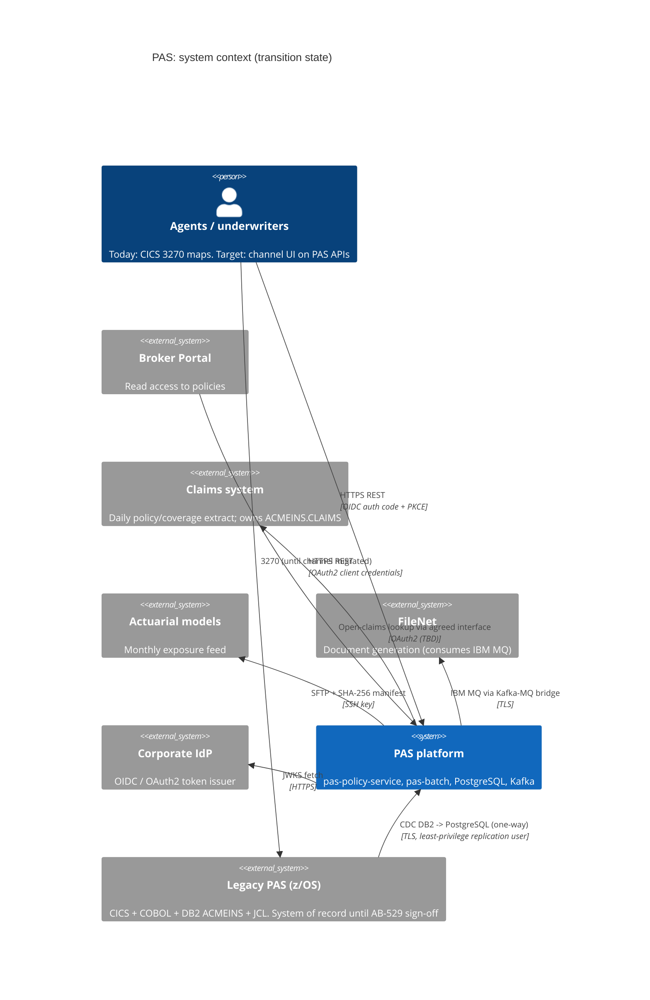
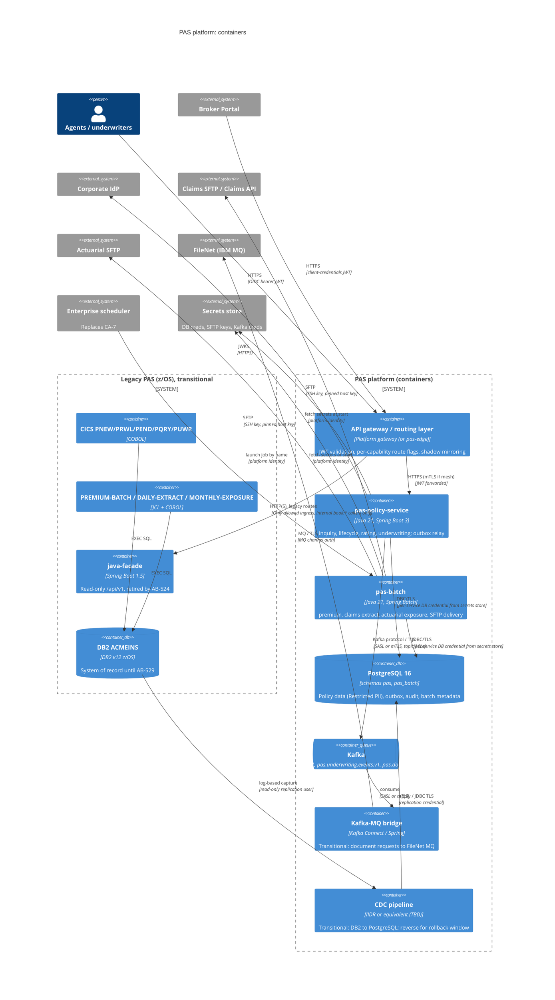
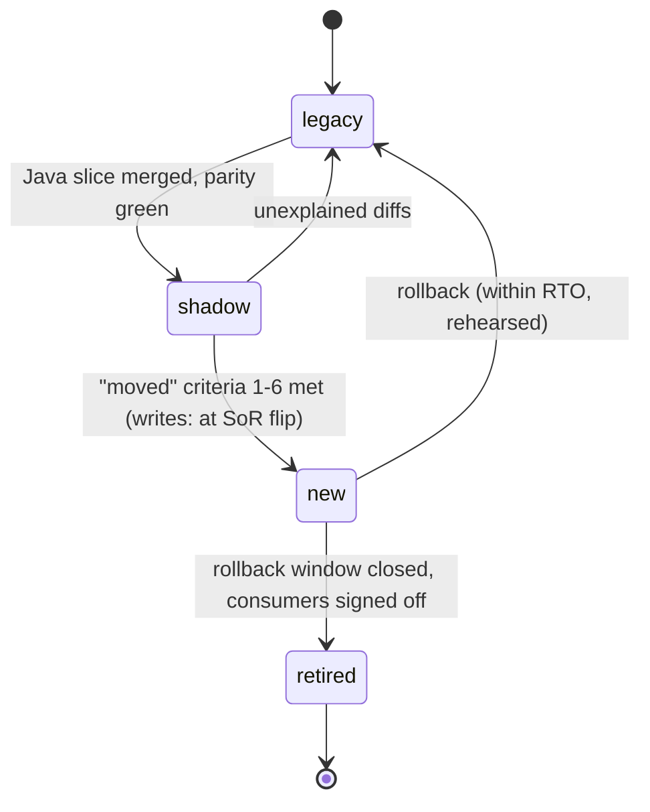

# 0001. PAS target architecture

- **Status:** Proposed
- **Date:** 2026-10-20
- **ARB ticket:** ARB-TBD (to be created). There is no ARB Jira project reachable from this work, so the ticket still has to be raised. The submission body is ready in [`arb/0001-submission.md`](arb/0001-submission.md). Merging to `main` waits on ARB approval.
- **Jira:** AB-518 (epic AB-516)
- **Authors:** PAS modernization team (drafted by Devin for AB-518)
- **Owning team:** PAS Platform team. TBD: name and on-call rotation to be confirmed before ARB.
- **Related ADRs:** none. This is the first ADR in the repository.
- **Related docs:** behaviour inventory, quirk register and open questions in [`docs/modernization/`](../modernization/) (AB-517, written in parallel; this ADR does not repeat it). Also the parity harness in [`parity/README.md`](../../parity/README.md) (AB-520), the backward-compat gate in [`compat/README.md`](../../compat/README.md), and local dev in [`docs/dev/local-dev.md`](../dev/local-dev.md) (AB-519).

## Context

The Policy Administration System (PAS) is the system of record for every Acme policy. Its current shape:

- **Online.** Five CICS transactions: PNEW/POLNEW, PRWL/POLRNW, PEND/POLEND, PQRY/POLQRY and PUWR/UNDWRT. They run on z/OS 2.5 with CICS TS 5.6 and use 3270 BMS maps.
- **Data.** DB2 v12 schema `ACMEINS` with POLICIES, COVERAGES, PREMIUMS, ENDORSEMENTS, UNDERWRITING_DECISIONS, POLICY_HOLDERS and TERRITORY_FACTORS, plus `POLICY_SEQ`. ACMEINS.CLAIMS belongs to the Claims team.
- **Batch.** PREMIUM-BATCH (PREMBAT, single-threaded, about 4 h for the full book), DAILY-EXTRACT (fixed-width LRECL 200/150 to Claims) and MONTHLY-EXPOSURE (LRECL 300 to Actuarial), scheduled by CA-7.
- **Integrations.**
  - Claims and Actuarial receive their files over **plain, unencrypted FTP** from JCL FTP steps.
  - The Broker Portal reads DB2 directly through a SQL Server linked server over ODBC.
  - POLNEW and UNDWRT `WRITEQ TD` the whole `POLICY-RECORD` to a queue bridged to IBM MQ, which triggers FileNet documents. Both are fire-and-forget: POLNEW ignores a failed write.
  - POLEND writes an `ENDORSEMENT-AUDIT` TS queue for regulatory audit.
- **Facade.** A read-only Spring Boot 1.5 / Java 8 REST facade (`GET /api/v1/policies/{n}` and `/coverages`) with **no authentication**. It relies on VPN segmentation. Related security findings: AB-365 (facade has no auth / BOLA) and AB-364 (renewal IDOR).

Epic AB-516 moves this onto Java 21 / Spring Boot 3 in containers. Policy numbers, premiums and downstream file layouts must stay the same. Success criteria from the epic:

- every transaction and job has a Java equivalent with automated parity tests;
- the premium batch finishes the full book in **under 30 minutes** and reruns are safe;
- all reads and writes go through authenticated, authorised APIs;
- there are no unencrypted file transfers;
- at least one full billing cycle of parallel run with zero unexplained differences comes before CICS and the batch schedule are switched off.

AB-519 already built a scaffold on provisional picks: `pas-platform/` with `pas-policy-service`, `pas-batch`, PostgreSQL 16 + Flyway and Kafka. AB-520 built the COBOL characterization harness (`make parity`). This ADR **ratifies those picks, amending one of them**, and decides the open questions the epic left for "Discover & decide".

Constraints:

- **Parity first.** Rating moves at parity, including its quirks. The only intentional changes are the ones signed off in the quirk register (AB-517) and table-driven factors behind a flag that stays off by default.
- **DB2 stays the system of record** until data migration and dual-run sign-off (AB-529).
- Fixed-width consumer layouts stay byte-identical (`compat/check_layouts.py`).
- The Claims engine, Broker Portal and FileNet are not re-platformed. We integrate with them.

**ARB triggers** (judged by hand against `rules/arb-triggers.md`; see [the submission](arb/0001-submission.md#triage)):

| Trigger | Why it fires |
| --- | --- |
| T1 | New deployables: `pas-policy-service`, `pas-batch` and a CDC pipeline. |
| T2 | New data stores holding Restricted PII: PostgreSQL `pas` and `pas_batch`, plus Kafka topics. |
| T4 | New async contracts (Kafka events replacing TDQ/MQ), new REST APIs and new file-delivery contracts. |
| T6 | New authenticated public APIs, an IdP integration and the SFTP network path. |
| T7 | New runtime: Java 21 / Spring Boot 3 replacing COBOL/CICS and Boot 1.5. |
| T8 | Spans several teams: PAS, mainframe, Claims, Actuarial, Broker Portal, FileNet, platform and security. |
| T3 / T5 | **To be confirmed by ARB.** It depends on whether managed PostgreSQL, Kafka, a schema registry, the CDC tool and the API gateway are already approved platform offerings. |
| T9 | **TBD.** No cost estimate exists yet (see [Cost](#cost)). |

## Decision

We will:

- build the PAS replacement as **two deployables**:
  - **`pas-policy-service`**: one service covering inquiry, lifecycle (new business, renewal, endorsement), rating and underwriting, kept internally modular;
  - **`pas-batch`**: one Spring Batch app covering premium recalculation, the daily Claims extract and the monthly Actuarial exposure feed.
- run both on **Java 21 / Spring Boot 3** as OCI containers on the standard container platform. We start on Boot 3.3 as scaffolded and move to a supported Boot line before any capability goes live.
- persist to **PostgreSQL 16** with Flyway-owned schemas `pas` and `pas_batch`, loaded from DB2 by a bulk load followed by one-way change data capture. DB2 stays the system of record until the AB-529 sign-off, and reverse replication covers the rollback window afterwards.
- publish domain events to **Kafka** through a transactional outbox, with versioned schemas. A transitional MQ bridge keeps FileNet working.
- protect every API with **OAuth2/OIDC JWT bearer tokens** (Spring Security resource server): one scope per capability, plus object-level entitlement checks on agent, branch and book-of-business claims.
- deliver files over **SFTP** with key-based auth, SHA-256 checksums and delivery receipts.
- migrate one capability at a time behind a **routing layer with a per-capability route flag** (`legacy` → `shadow` → `new`). A capability only flips to `new` when it meets the ["moved" definition](#d7-strangler-routing-and-the-moved-rule).

The sections below record each decision (D1–D7), the reasoning and the alternatives considered.

### D1. Service boundaries

**Decision.** One `pas-policy-service` and one `pas-batch`. We do **not** build one service per CICS transaction.

- `pas-policy-service` (port 8080, packages `com.acme.insurance.pas.policy.{inquiry,lifecycle,rating,underwriting}`) owns all online policy behaviour and the REST API (`/api/v2/...`, plus `/api/v1/...` compatibility for facade consumers in AB-524).
- `pas-batch` (port 8081, packages `com.acme.insurance.pas.batch.{premium,extract,exposure}`) owns all scheduled jobs. Its job metadata lives in the `pas_batch` schema.
- **Rating is a pure library, not a network service.**
  - `PremiumCalculator` (already matching PREMBAT goldens) has no I/O; since AB-522 it lives in the shared `pas-rating` library module (package `com.acme.insurance.pas.rating`, moved with the module so no package is split across jars) with its rates in the `pas` reference tables. Spring JDBC/auto-configuration are optional dependencies of the module; the engine itself is plain Java. The online path (quotes, renewals, endorsements) and the premium batch both link it in-process.
  - When AB-523 needs it in `pas-batch`, it moves from `pas-policy-service`'s `rating` package into a dependency-free `pas-rating` Maven module. The package name and API stay the same.
  - A remote rating call per policy would put a network hop inside the < 30 min full-book run.
- **Module boundaries inside the service are enforced.**
  - Packages talk only through each package's public API. No cross-package repository access is allowed.
  - An ArchUnit rule will guard this (see the proposed follow-up tickets). Splitting a package out later then becomes a deployment change, not a rewrite.

**Why.**

- All five transactions read and write the same POLICIES row and its children, inside one DB2 unit of work (POLNEW inserts POLICIES and COVERAGES and calls underwriting; POLRNW re-rates; POLEND adjusts premium). Splitting them per transaction would turn local ACID transactions into distributed sagas over one aggregate, with no independent scaling or ownership need to justify it.
- One team owns PAS, so per-transaction services would add 5× the pipelines, on-call surface and contract versioning for one team.
- The load profile is two-shaped: request/response (online) and throughput (batch). Those are the two units that genuinely need to scale and deploy separately.

**When to revisit (split triggers).** A package becomes its own service only if at least one of these holds: a different owning team, a materially different scaling profile (e.g. an external quote API at broker-portal volume), or a release cadence that the shared deployable blocks. A split needs a superseding ADR.

| Alternative | Pros | Cons | Why rejected |
| --- | --- | --- | --- |
| Do nothing (stay on CICS/COBOL) | No migration risk | Fails every epic goal: no write API, MIPS cost, COBOL key-person risk, EOL facade | Rejected by the epic's business case |
| One microservice per CICS transaction (5 online + 3 batch) | Mirrors the legacy inventory; small codebases | Distributed transactions over one aggregate; 8 pipelines and on-calls for one team; rating duplicated or remote | Cost and consistency risk with no matching benefit |
| Single deployable (online + batch in one app) | Simplest to deploy | Batch load affects online latency; batch can't scale independently; long-running jobs block rolling deploys | Online and batch have different scaling and availability needs |
| Separate rating service | Reusable by other channels | Network hop per policy in the batch; more availability coupling | Not needed now. The library can be wrapped as a service later if a second consumer appears |

### D2. Runtime

**Decision.**

- **Language and framework.** Java 21 (LTS), Spring Boot 3 and Spring Batch 5, built with the Maven wrapper.
  - Images are multi-stage, from `eclipse-temurin:21-jdk` to `eclipse-temurin:21-jre`, and run as non-root.
  - Builds stay reproducible and pinned, as scaffolded in AB-519.
- **Deployment.** OCI containers on the standard container platform (Kubernetes assumed; platform team to confirm). Each deployable gets its own image, config via environment variables (`PAS_DB_URL`, `PAS_DB_USERNAME`, `PAS_DB_PASSWORD`, `PAS_KAFKA_BOOTSTRAP_SERVERS`, …) and Kubernetes liveness/readiness probes.
- **Batch execution.**
  - The enterprise scheduler replaces CA-7 and launches jobs by name. `spring.batch.job.enabled=false` is already set; the trigger shape (a run-to-completion container per job, or an authenticated launch call) is AB-523's call.
  - The `pas_batch` JobRepository enforces single-instance execution and restart-from-failure.
  - The premium job is partitioned by policy-number range and chunk-oriented, to meet the < 30 min target. Reruns for the same run date are idempotent (replace), which removes the PREMIUMS same-day primary-key collision (AB-523).
- **Arithmetic.** `BigDecimal` everywhere, with scale matching the COBOL PIC. `RoundingMode.DOWN` is used where COBOL `COMPUTE` truncates (no `ROUNDED`). `pas-common` `Money` (HALF_UP) is only used where the legacy code rounds.
- **Amendment to the AB-519 pick (Boot version).** The scaffold pins Spring Boot **3.3.13**, which is **past OSS support**. Trivy already reports CRITICAL/HIGH findings: Tomcat is overridden to 10.1.61, and CVE-2026-47884 has a time-boxed ignore in `.github/trivy/trivyignore.yaml`. We ratify Boot 3 as the runtime line, but **no capability may reach `new` routing on Boot 3.3**:
  - move to the latest supported **Spring Boot 3.5.x** (proposed follow-up ticket);
  - before cutover, assess Spring Boot 4 / Framework 7, which is where the XsltView CVE is fixed. That assessment needs its own ADR if adopted.

| Alternative | Pros | Cons | Why rejected |
| --- | --- | --- | --- |
| Do nothing (COBOL on z/OS) | Proven | MIPS cost, skills risk, no CI/CD | Epic goal |
| Rehost COBOL (Micro Focus / mainframe emulation on Linux) | Fastest exit from hardware | Keeps COBOL skills risk; vendor lock-in and licence cost; doesn't fix FTP, auth or hardcoded rating | Moves the problem without fixing it; new vendor (T3/T9) |
| Automated COBOL→Java transpilation | Fast first cut | Unidiomatic code ("JOBOL"); keeps quirks without the preserve/fix decisions; hard to maintain | Defeats the maintainability goal; parity is cheaper to prove on hand-ported code with goldens |
| Quarkus / Micronaut | Faster startup, smaller images | Smaller in-house skill base; Spring Batch has no equal | Spring Boot is the enterprise standard and Spring Batch covers the batch needs |
| Stay on Boot 3.3 | No upgrade work now | Unsupported line, unpatched CVEs | Rejected. Upgrade required before go-live (amendment above) |

### D3. Target database, migration and DB2 coexistence

**Decision.** **PostgreSQL 16**, as the platform's managed PostgreSQL offering in production and `postgres:16` locally.

- **Schemas.** Flyway owns the `pas` schema (`pas-policy-service`) and the `pas_batch` schema (`pas-batch` Spring Batch metadata). Applied migrations are immutable; `compat/check_schema.py` already rejects edits to them.
- **One database, two schemas, two credentials.** `pas-batch` gets DML on the `pas` tables it processes (premiums, extracts) and DDL only on `pas_batch`. `pas-policy-service` has no access to `pas_batch`.
- **Type mapping (owned by AB-521).**
  - `DECIMAL(p,s)` maps to `NUMERIC(p,s)` with the same precision.
  - `CHAR(n)` keys keep fixed width, so blank-padding comparisons behave as in DB2.
  - `TIMESTAMP` maps to `timestamp` (UTC; the time zone convention is fixed in AB-521).
  - `POLICY_SEQ` maps to a PostgreSQL sequence whose start value is set at cutover from DB2's `NEXT VALUE`. That keeps policy numbers continuous and collision-free.
- **PII.** POLICY_HOLDERS has `DATE_OF_BIRTH`, `SSN_LAST4`, `TAX_ID`, `CREDIT_SCORE`, names, address, phone and email.
  - It is classified **Restricted**.
  - `TAX_ID` and `SSN_LAST4` get application-level field encryption or tokenization, on top of storage encryption. AB-521 picks the mechanism.
  - Read access to the decrypted values is a separate scope (see D5).

**Migration and coexistence.** Code moves first and data moves once.

1. **Initial load.** Bulk unload from DB2 (UNLOAD or HPU), transform, then `COPY` into `pas`.
2. **Continuous delta.** One-way **CDC DB2 → PostgreSQL** keeps `pas` a near-real-time replica while DB2 stays the system of record.
   - Tool: IBM InfoSphere Data Replication (IIDR) for z/OS, or the mainframe team's existing replication product. Debezium's Db2 connector only supports Db2 LUW, not z/OS. To be confirmed.
   - **Fallback** if CDC isn't available: `LAST_UPDATED`-watermarked deltas (POLICIES and POLICY_HOLDERS carry it). Tables without `LAST_UPDATED` are handled by AB-529 (full-table compare or added triggers).
   - The CDC pipeline is a **transitional** component. It holds full PII and gets least-privilege, read-only DB2 access.
3. **Before the system-of-record flip.** Java capabilities run against `pas` in `shadow` mode (D7).
   - Reads and extracts can move to `new` earlier, as long as replica staleness is acceptable for that consumer. Extracts only run once the CDC watermark has passed the business cut-off time.
   - Write capabilities (POLNEW, POLRNW, POLEND, UNDWRT, premium batch) run in shadow and are compared with what CICS/PREMBAT wrote to DB2, but **their results are not authoritative**.
   - **Shadow isolation.** Before the flip, `pas` is written **only** by the CDC pipeline. Shadow writes never touch it, so reads, extracts and reconciliation always see DB2 truth.
     - Shadow write paths read their inputs from `pas` and write their outputs to a separate schema, **`pas_shadow`**. Only the shadow-mode datasource can write to it. Pure calculations (rating, underwriting score) can instead run without committing anything.
     - The shadow premium batch writes PREMIUMS output to `pas_shadow` as well, never to `pas`.
     - **Shadow storage model.** `pas_shadow` is a comparison staging model, not a mirror of `pas` constraints.
       - Each output table has the same columns as its `pas` counterpart plus `shadow_run_id` and `cdc_position`.
       - It has **no foreign keys** to parent tables, because the parents of existing policies live in `pas` and PostgreSQL can't enforce a constraint against a CDC-managed replica.
       - Referential integrity is checked by the comparison job instead: every shadow child must resolve to a parent in `pas` or in the same `shadow_run_id`. A child that doesn't resolve is reported as a parity failure.
       - New business (POLNEW) writes its POLICIES/COVERAGES parent and child rows together in the same run.
       - AB-529 validates the model against premium, endorsement and new-business shadow writes.
     - **Watermark alignment.** Each shadow run records the CDC position (log sequence or `LAST_UPDATED` watermark) of the inputs it read. Its output is compared with the DB2 result once CDC has passed the source transaction's commit, keyed by policy number + business date. An input that changed between the shadow read and the compare is reported as "input drift", not as a parity diff, and is retried.
     - `pas_shadow` is truncated per comparison window and dropped at the system-of-record flip.
4. **Reconciliation, run daily and on demand (AB-529).**
   - Per-table row counts and per-row key + column hashes.
   - Financial control totals (`SUM(TOTAL_PREMIUM)`, premiums by run date, coverage limits).
   - Sequence high-water marks.
   - The bar is zero unexplained differences. Every accepted difference is a `parity/known-differences.json` entry whose `decision` points at `docs/modernization/quirk-register.md`.
5. **System-of-record flip (AB-529/AB-530).**
   - Brief write freeze on CICS, final delta, reconcile, set the sequence, then flip all write routes to `new` in one window. All five online transactions share the POLICIES aggregate, so writes cannot be split between two systems of record.
   - **Reverse replication PostgreSQL → DB2** runs for the rollback window (proposed: one full billing cycle). DB2, CICS and JCL stay consistent and can be reactivated.
   - DB2 is decommissioned after the window closes and consumers sign off.

| Alternative | Pros | Cons | Why rejected |
| --- | --- | --- | --- |
| Do nothing (stay on DB2 z/OS; Java connects via JCC) | No data migration; single system of record | Keeps MIPS and the mainframe dependency, so the decommission goal is unreachable. Container → z/OS connectivity is on the critical path | Doesn't meet the epic's decommission goal |
| "Code first on DB2, data later" (Java writes to DB2 during transition, then switch datasource) | Per-capability write moves before data migration | Java built twice against two dialects; Flyway schema unexercised until late; batch performance bound by DB2/MIPS; DB2 network path from the platform | Doubles test surface. CDC + shadow mode gives the same safety with one target schema |
| Bidirectional sync / dual writes during transition | Per-capability write moves at any time | No atomicity across two systems of record; conflict resolution on one aggregate; reconciliation can't converge | Correctness risk too high for the system of record |
| Db2 LUW on Linux | Closest dialect | Licence cost; small skill pool; still a niche DB on the platform | No advantage over PostgreSQL once code is ported |
| Oracle / SQL Server | Mature, enterprise-supported | Licence cost; no functional need | Cost, with no benefit over PostgreSQL |
| Document / NoSQL store | Flexible schema | Policy data is relational with financial constraints; downstream reconciliation is SQL | Wrong model for the data |

### D4. Messaging (replacing CICS TDQ / IBM MQ)

**Decision.** **Kafka**, using the platform-managed cluster in production and the KRaft single node from `docker-compose.yml` locally.

- **Topics.** Final names are set in AB-528. The key is the policy number, so each policy's events stay ordered.
  - `pas.policy.events.v1`: `PolicyIssued`, `PolicyRenewed`, `PolicyEndorsed`, `PolicyPremiumRecalculated`.
  - `pas.underwriting.events.v1`: `UnderwritingReferred`, `UnderwritingDecided`.
  - `pas.document.requests.v1`: `DocumentRequested`, for FileNet.
- **Schemas.**
  - Event contracts are versioned in the repo and checked in CI for **backward compatibility**. A breaking change means a new `.v2` topic, never an in-place edit.
  - We use JSON Schema, and a schema registry if the platform provides one. Otherwise schemas are a contract module.
  - Every event carries `eventId` (UUID), `eventType`, `schemaVersion`, `occurredAt`, `policyNumber`, `policyVersion` (the optimistic-lock version of the committed state) and `correlationId`.
- **PII minimisation.** Today the TDQ payload is the entire `POLICY-RECORD`. Events carry identifiers and business facts only, with no policyholder PII. Consumers that need PII call the authorised API.
- **Transactional outbox.**
  - `pas-policy-service` writes events to a `pas.outbox` table in the same transaction as the state change. A relay publishes them to Kafka.
  - Delivery is at-least-once and consumers dedupe on `eventId`.
  - This fixes the legacy behaviour where POLNEW silently drops the message when `WRITEQ TD` fails.
- **Audit.** The POLEND `ENDORSEMENT-AUDIT` TS queue is replaced by a durable audit table in `pas` (AB-526/AB-528). It also emits a `PolicyEndorsed` event. Audit is not left to a broker's retention policy.
- **FileNet (transitional).** FileNet keeps consuming IBM MQ until it can consume Kafka (FileNet re-platforming is out of scope).
  - A **Kafka → MQ bridge** feeds the existing FileNet queue from `pas.document.requests.v1`. The bridge is a Kafka Connect IBM MQ sink with a hydration transform, or a small bridge in `pas-policy-service`; AB-528 decides.
  - **Hydration.** `DocumentRequested` is deliberately minimal, so the bridge cannot build FileNet's fixed-width `POLICY-RECORD` from the event alone.
    - The bridge fetches the policy at exactly `policyVersion` through an authenticated internal read: client credentials with `policy:read` and `book:*`, and no `policy:pii:read`. In-process, it reads the same committed row.
    - It then builds the `POLICY-RECORD` layout byte for byte (COMP-3 packing, blank padding, FILLER) from the copybook.
    - `POLICY-RECORD` carries `POLICY-HOLDER-ID` but no POLICY_HOLDERS PII (no name, DOB, SSN, tax ID or contact details). So nothing it needs is masked under `policy:read`.
      - A contract test in AB-528 asserts this field-by-field against the copybook.
      - If a future layout needs a protected field, the bridge gets a dedicated narrowly scoped client and a Security review. It never falls back to masked values.
    - If that version is no longer readable, the bridge does not send a partial record. It retries and then dead-letters with an alert.
    - In `shadow`, the bridge output is compared byte-level with the TDQ payload CICS wrote. `document-events` only moves to `new` with FileNet consumer sign-off on that comparison.
  - The alternative is to version FileNet's MQ contract to the minimal event. That is FileNet-side work and out of scope, so it is not chosen; it can be revisited with FileNet sign-off.
  - The bridge is retired when FileNet consumes Kafka directly, or when MQ is decommissioned.
- **Access control.** Kafka ACLs are per topic and per principal: only `pas-policy-service` and `pas-batch` produce, and each consumer group gets read access only to the topics it needs. Connections use TLS and SASL/mTLS (D5).

| Alternative | Pros | Cons | Why rejected |
| --- | --- | --- | --- |
| Do nothing (keep CICS TDQ → IBM MQ) | No consumer change | Tied to CICS, which we're decommissioning; fire-and-forget loses messages | Can't outlive CICS |
| IBM MQ on distributed platforms | FileNet already speaks MQ; strong delivery guarantees | No replay or log retention; single-consumer queues need fan-out config per consumer; no alignment with CDC | Kept as a transitional bridge only. Kafka better suits multiple consumers and replay |
| RabbitMQ | Simple; good routing | No durable replayable log; another platform to run | Replay and multi-consumer fan-out matter for reconciliation and new consumers |
| Cloud-native queue/topic (e.g. SNS/SQS) | Fully managed | Ties the design to one cloud; ordering per key is limited | Platform portability; Kafka is already in the local stack and the AB-519 scaffold |
| Direct DB polling by consumers | No broker | Recreates the Broker Portal's direct-DB coupling | That's the anti-pattern AB-528 removes |

### D5. Authentication and authorization for the new APIs

**Decision.**

- **AuthN.** OAuth2 / OIDC **JWT bearer tokens** issued by the corporate IdP, which is already approved (to be confirmed by Security).
  - Both services are Spring Security **resource servers**. They validate signature (JWKS), `iss`, `aud` (`pas-api`), `exp`/`nbf` and allowed algorithms.
  - Config keys: `spring.security.oauth2.resourceserver.jwt.issuer-uri=${PAS_OIDC_ISSUER_URI}` and `spring.security.oauth2.resourceserver.jwt.audiences=${PAS_OIDC_AUDIENCE}`. The final keys are set in AB-524.
  - System clients (Broker Portal, Claims, Actuarial tooling, FileNet bridge) use the **client-credentials** flow. Human channels use authorization code + PKCE through their front end.
- **Coarse authZ: one scope per capability.**

  | Scope | Grants |
  | --- | --- |
  | `policy:read` | Inquiry (POLQRY / v1 facade parity), coverages |
  | `policy:pii:read` | Unmasked policyholder PII (otherwise masked) |
  | `policy:write` | New business, renewal, endorsement (POLNEW / POLRNW / POLEND) |
  | `underwriting:decide` | Underwriting decisions (UNDWRT) |
  | `rating:quote` | Side-effect-free premium quote |
  | `batch:operate` | Launch, stop and restart batch jobs (if exposed over HTTP) |

- **Fine authZ: object-level entitlement.** This fixes the BOLA/IDOR findings in AB-364 and AB-365.
  - Each request is checked against the caller's claims: `agent_code` (matches `POLICIES.AGENT_CODE`), `branch_code` (matches `BRANCH_CODE`) and `book` (book-of-business list). Internal underwriting and service roles carry an explicit `book:*`.
  - The check runs in the service layer, not only at the gateway.
  - A denied object returns **404**, the same as not-found, so policy numbers can't be enumerated.
- **Gateway.** The gateway also validates tokens (defence in depth), but **the service's own checks are the authoritative ones**.
- **Legacy facade during transition.** `java-facade` has no auth, and the gateway cannot do object-level checks for it. So until `inquiry` reaches `retired`:
  - **Network-locked.** The facade only accepts traffic from the gateway (Kubernetes NetworkPolicy / security group, plus mTLS if the mesh provides it). Every other path to it is closed, including direct Broker Portal and staff access.
  - **Internal callers only.** Legacy facade routes accept only internal staff and service tokens that carry `policy:read` and `book:*`. Callers that need object-level filtering (Broker Portal, agents) are **not** routed to the facade. They go through `broker-read` → `pas-policy-service` (AB-524), which enforces entitlements.
  - **Residual risk.** If AB-524 slips and a restricted caller has to use the facade, an entitlement filter is added to the facade under AB-365 first. That is a `java-facade` change, so it is scoped and approved separately. Until then the facade remains the open finding AB-365, and it is listed under risks.
- **Actuator.**
  - Only `health` (liveness/readiness) and `prometheus` are exposed, as already scaffolded.
  - In deployed environments they move to a separate management port, reachable only from the platform network (probes and metrics scraper), never through the gateway.
  - `show-details=never` stays. Every other endpoint is denied.
- **Legacy compatibility.** When `/api/v1` gains auth, `compat` will report status-code changes. Those go in `compat/allowed-changes.json` under AB-524, and the compat run uses `COMPAT_AUTH_HEADER`.
- **Implementation (AB-524).** `pas-policy-service` package `policy.security`: `SecurityConfig` (only the three health probe paths are anonymous; `/api/v1/policies/**` needs `SCOPE_policy:read`; everything else needs a valid JWT), `JwtDecoderConfig` (validates signature, `iss`, `aud`, `exp`/`nbf`, RS256; keys from `jwk-set-uri`, else OIDC discovery on `PAS_OIDC_ISSUER_URI` resolved lazily; `public-key-location` only for the `local` profile and tests), `CallerEntitlements` (`book` entries `*` / `book:*`, `agent:<code>`, `branch:<code>`; codes compared trimmed and case-insensitive) and `PasScopes`. `PAS_OIDC_ISSUER_URI` and `PAS_OIDC_AUDIENCE` have no default outside the `local` profile. Actuator: every endpoint except `health` and `prometheus` is disabled; `prometheus` needs a JWT until the separate management port lands (open question in `docs/modernization/open-questions.md`). The facade itself is unchanged, so `compat/allowed-changes.json` needs no entry in AB-524. Status: Proposed — Pending: Security, Pending: ARB.
- **Write auditing.** Every write records `sub`, `client_id`, scopes, `policyNumber`, action and correlation id to an audit log. The 8-character legacy `UPDATED_BY` gets a deterministic mapping (AB-521).

| Alternative | Pros | Cons | Why rejected |
| --- | --- | --- | --- |
| Do nothing (network segmentation only, like the facade) | Zero work | Already an open finding (AB-365); fails the epic's success criterion | Rejected |
| API keys per consumer | Simple | No user identity; rotation pain; no standard scopes or claims | Not adequate for object-level authZ or audit |
| mTLS only | Strong client auth | Identifies systems, not users or agents; no entitlements | Used for east-west transport if the mesh provides it, not as API authZ |
| Gateway-only auth (services trust the gateway) | One enforcement point | Any bypass of the gateway is a full bypass; object-level checks need domain data | Defence in depth required |

### D6. Secure file transfer (Claims and Actuarial feeds)

**Decision.** **SFTP** from `pas-batch` replaces the JCL FTP steps.

- **Auth.** SSH key only; no password logins.
  - Private keys come from the secrets store at runtime and are never baked into images or committed (`compat/check_security.py`).
  - The server host key is pinned (known_hosts from config). Keys rotate at least annually; the period is set by security policy.
- **Integrity.**
  - Upload as `<name>.part`, then atomically rename to the final path the consumer expects today (`/claims/import/policy_extract.dat`, `/claims/import/coverage_extract.dat`, `/actuarial/data/exposure_monthly.csv`).
  - Alongside it, upload a `<name>.sha256` sidecar and a manifest with record count, byte length, SHA-256, run date and job execution id.
- **Delivery receipt.**
  - After upload, `pas-batch` re-stats the remote file (size) and records a transfer row: job execution id, file, checksum, record count, remote path, timestamp, outcome.
  - Where the consumer can, it writes an ack file that the job polls for, with a timeout and an alert on miss.
  - A failed transfer fails the step. The step can be restarted without regenerating the file, so retries are safe.
- **Layout parity.** Record layouts (LRECL 200, 150, 300) stay byte-identical to what consumers receive today. AB-527 captures the current bytes received after FTP ASCII conversion and record delimiting, and compares byte-for-byte.
- **Transport and storage.** Encryption in transit comes from SSH. Whether the files also need PGP encryption at rest on the consumer side (they contain policy data) is an open question for Security and data governance.

| Alternative | Pros | Cons | Why rejected |
| --- | --- | --- | --- |
| Do nothing (plain FTP) | No consumer change | Cleartext policy data and credentials; regulatory finding | Rejected (epic success criterion) |
| FTPS | TLS on the existing FTP model | Firewall-unfriendly (data channels); weaker tooling | SFTP is simpler to operate and is the consumer-side norm |
| Enterprise managed file transfer (MFT) hub | Central audit, retries, PGP | Possible new vendor or onboarding; adds an intermediary | **Preferred if the enterprise already runs one.** Then `pas-batch` SFTPs to the MFT hub, and the integrity and receipt rules stay the same (open question) |
| API / event push of extract data | Modern; no files | Consumers depend on fixed-width files; Claims and Actuarial re-platforming is out of scope | Consumer change out of scope |
| Object storage drop (bucket + signed URLs) | Managed, encrypted | Consumers must change how they ingest | Same as above |

### D7. Strangler routing and the "moved" rule

**Decision.**

- **Routing layer.** An **API gateway / routing layer** sits in front of the legacy facade and `pas-policy-service`. It uses the platform's standard gateway, or a thin Spring Cloud Gateway `pas-edge` if the platform has none (open question).
- **Route flags.** Each capability has a route flag, kept in version control and changed through a reviewed config PR. Changing a flag needs no redeploy.

  | Flag | Behaviour |
  | --- | --- |
  | `legacy` (default) | Legacy serves. New path not called. |
  | `shadow` | Legacy serves and is authoritative. Reads are mirrored to the new path and the responses compared. Writes and batch run the new path with inputs from `pas` and outputs to the isolated `pas_shadow` schema (D3 step 3), without publishing externally (no SFTP delivery, no Kafka publish to external consumers, not the system of record). The outputs are compared. |
  | `new` | New path serves and is authoritative. Legacy stays warm for the rollback window. |
  | `retired` | Legacy path removed (AB-530). |

- **Capabilities** (each with its own flag): `inquiry` (POLQRY + `/api/v1` facade), `new-business` (POLNEW), `underwriting` (UNDWRT), `renewal` (POLRNW), `endorsement` (POLEND), `premium-batch` (PREMBAT), `claims-extract` (DAILY-EXTRACT), `actuarial-exposure` (MONTHLY-EXPOSURE), `document-events` (TDQ/MQ), `broker-read` (Broker Portal linked server → inquiry API).
- **Batch capabilities** are routed by the scheduler. Both the JCL job and the `pas-batch` job run, and only the authoritative one delivers and writes the system of record.
- **CICS 3270 users.** The routing layer covers HTTP consumers only. People who use the CICS 3270 maps today need a client of the new APIs before write capabilities can go `new`. Who builds that channel is an open question; it is not in the epic's scope today.
- **Write ordering.** Write capabilities can individually reach "ready" in `shadow`, but they flip to `new` **together** at the system-of-record flip (D3 step 5).

**A capability is "moved"** (allowed to go from `shadow` to `new`) only when **all** of the following are true, recorded in its ticket and the PR that changes the flag:

1. **Parity green.** Its `make parity` program(s) and the compat gate pass in CI. Every difference from COBOL is a `parity/known-differences.json` entry whose `decision` links a signed-off row in `docs/modernization/quirk-register.md`.
2. **Parallel run clean.** It ran in `shadow` on production traffic or data with **zero unexplained differences**:
   - at least **one full billing cycle** for write and batch capabilities and file feeds;
   - for read-only capabilities, a window agreed with the consumer. TBD: owner to confirm.
3. **Consumer sign-off.** Every downstream consumer of the capability (Claims, Actuarial, Broker Portal, FileNet, channel owners) signed off, including a byte-level file comparison for feeds.
4. **Rollback rehearsed.** Flipping back to `legacy` was rehearsed in pre-production within the RTO, including data: for writes after the system-of-record flip, reverse replication keeps DB2 consistent.
5. **NFRs met.** Latency, availability and throughput targets are met in a production-like environment; for `premium-batch`, the full book runs in under 30 minutes and a same-date rerun produces identical results.
6. **Secure and operable.**
   - Authenticated and authorised per D5, with entitlement tests.
   - Security scan clean, or exceptions recorded.
   - Runbook, dashboards and alerts in place, and the on-call team accepted it.

After the rollback window closes with no rollback, the capability moves to `retired` and its legacy code, JCL or route is removed in AB-530.

| Alternative | Pros | Cons | Why rejected |
| --- | --- | --- | --- |
| Do nothing / big-bang cutover | One switch | All risk in one night; no evidence before cutover; rollback is all-or-nothing | Contradicts the epic's strangler approach |
| Routing inside the legacy facade | No new hop | Facade is EOL Boot 1.5 with no auth; it would grow new responsibilities | We're retiring it |
| Client-side switching (each consumer chooses endpoint) | No gateway | N consumers × M capabilities to coordinate; no central shadowing | No shadow mode; rollback needs every consumer |
| Feature flags inside `pas-policy-service` only | Simple | Can't route traffic away from legacy; no read mirroring | Doesn't cover legacy consumers |

## Architecture

### C4 context (target, during transition)

### C4 container (target)

### Capability routing states

### New components and data stores (for security and data governance review)

| # | Component / data store | Kind | Lifetime | Data classification | Owner | Notes |
| --- | --- | --- | --- | --- | --- | --- |
| 1 | `pas-policy-service` | Deployable (container) | Permanent | Processes Restricted PII | PAS Platform | Public API via gateway; JWT resource server |
| 2 | `pas-batch` | Deployable (container / job) | Permanent | Processes Restricted PII | PAS Platform | Scheduled; SFTP client |
| 3 | PostgreSQL 16, schema `pas` | Data store | Permanent | **Restricted** (policyholder PII, financials) | PAS Platform (DBA: platform) | Field-level protection of TAX_ID / SSN_LAST4 (AB-521) |
| 4 | PostgreSQL 16, schema `pas_batch` | Data store | Permanent | Internal (job metadata, transfer log) | PAS Platform | Spring Batch JobRepository |
| 5 | `pas.outbox` table | Data store (table) | Permanent | Confidential (event payloads, no PII) | PAS Platform | Purged after publish + retention TBD |
| 6 | `pas` audit table(s) (endorsement / write audit) | Data store (table) | Permanent | Confidential | PAS Platform | Replaces ENDORSEMENT-AUDIT TS queue; retention per records policy TBD |
| 7 | Kafka topics `pas.policy.events.v1`, `pas.underwriting.events.v1`, `pas.document.requests.v1` | Data store (log) + async contract | Permanent | Confidential (no PII by design) | PAS Platform | Topic ACLs; retention TBD |
| 8 | Event schemas (contract module / registry) | Shared contract | Permanent | Internal | PAS Platform | Backward-compat checked in CI |
| 9 | CDC pipeline DB2 → PostgreSQL (and reverse for rollback) | Deployable / vendor tool | **Transitional** (until DB2 decommission) | Restricted (full row images) | Mainframe team + PAS Platform | Tool TBD. Possible T3/T5 |
| 10 | Kafka → MQ bridge | Deployable / connector | **Transitional** | Confidential (hydrated POLICY-RECORD: holder id, agent, premiums; no policyholder PII) | PAS Platform | Until FileNet consumes Kafka. Reads policy via `policy:read` client credentials |
| 15 | PostgreSQL 16, schema `pas_shadow` | Data store | **Transitional** (dropped at system-of-record flip) | Restricted (shadow copies of policy and premium rows) | PAS Platform | Shadow-mode outputs only; never read by consumers; truncated per comparison window |
| 11 | API gateway routes + route-flag config | Infra config | Permanent (flags transitional) | N/A | PAS Platform / platform team | Platform gateway preferred |
| 12 | IdP client registrations and scopes (`pas-api` audience) | Identity config | Permanent | N/A | Security / IAM | One client per consumer system |
| 13 | SFTP credentials (SSH keypairs) and host-key pins | Secrets | Permanent | Secret | PAS Platform | Stored in secrets store, rotated |
| 14 | Database, Kafka and replication credentials | Secrets | Permanent / transitional | Secret | PAS Platform | Per-service, least privilege |

## Non-functional requirements

| NFR | Target | How met |
| --- | --- | --- |
| Availability SLO (online API) | TBD (owner to confirm before ARB). Must be at least the current CICS region availability, which AB-517 should capture | ≥ 2 replicas across zones; stateless service; readiness gates on DB |
| p95 latency (inquiry / writes) | TBD (owner to confirm before ARB). Baseline from CICS transaction response times | Indexed lookups by policy number; connection pooling; no remote rating call |
| Premium batch duration | **Full book < 30 min** (epic success criterion; today ≈ 4 h) | Spring Batch partitioned step by policy-number range, chunked JDBC writes, in-process rating |
| Batch rerun safety | **Same-date rerun is safe and idempotent** (epic) | Replace-by-run-date semantics (AB-523); JobRepository restartability |
| RPO / RTO | TBD (owner to confirm before ARB) | Managed PostgreSQL PITR backups; Kafka replication factor ≥ 3; route-flag rollback to legacy during the transition |
| Peak load | TBD. Policy count, daily transaction volume and peak TPS to come from AB-517 / mainframe SMF data | Horizontal scaling of `pas-policy-service`; batch partitions sized to book size |
| Scaling model | Online: horizontal (HPA on CPU/latency). Batch: partition count / worker threads per job | Stateless containers; single DB primary (read replicas if needed later) |
| Data retention | TBD. Policy records follow the regulatory retention schedule; outbox, audit and topic retention to be set by data governance | Flyway-managed purge jobs; Kafka topic retention config |
| CDC replication lag (transition) | TBD. Must be ≤ the staleness each early-moved read consumer accepts | CDC monitoring + lag alert; extracts gated on watermark ≥ cut-off |
| Observability | Every service exposes liveness/readiness, Prometheus metrics, JSON logs with correlation id | Already scaffolded (AB-519); tracing per platform standard |

## Security & compliance

- **Data classification.** Restricted: policyholder PII in POLICY_HOLDERS (DOB, SSN last 4, tax id, credit score, contact data). Confidential: policy financials, events and extracts.
- **Encryption at rest.**
  - Managed PostgreSQL storage encryption with a platform KMS key (CMK alias TBD by platform).
  - Application-level field encryption or tokenization for `TAX_ID` / `SSN_LAST4` (AB-521).
  - Kafka broker storage encryption (platform).
  - SFTP landing directories are the consumers' responsibility. PGP at rest is an open question.
- **Encryption in transit.** TLS 1.2+ on every hop:
  - client → gateway → service (mTLS if the platform mesh provides it);
  - JDBC with `sslmode=verify-full`;
  - Kafka with SASL_SSL or mTLS;
  - SSH for SFTP;
  - TLS on the CDC channel from z/OS and on the MQ channel to FileNet.
- **AuthN / AuthZ.** As in [D5](#d5-authentication-and-authorization-for-the-new-apis): OIDC JWT resource server, one scope per capability, object-level entitlements on agent, branch and book claims, 404 on a denied object, actuator on an internal management port only.
- **Secrets management.**
  - Every credential comes from the platform secrets store at runtime through environment variables. The variable names are already in the scaffold (`PAS_DB_PASSWORD` etc.).
  - Nothing is committed or baked into images. `compat/check_security.py` blocks hardcoded secrets and plaintext FTP in PRs.
  - Local development uses `.env` from `.env.example` only.
- **Audit logging.**
  - Every write records the authenticated principal, client, scopes, action, policy number and correlation id.
  - An endorsement audit table replaces the ENDORSEMENT-AUDIT TS queue.
  - Every file transfer writes a transfer log row.
  - Logs exclude PII; masked by default.
- **Data residency / regions.** TBD. Expected to match the current data-centre jurisdiction; to be confirmed with data governance and the state insurance regulatory requirements.
- **Policy sections satisfied.**
  - No IaC is added by this ADR.
  - `policy/approved-infra.yaml` isn't in this repository, and the org copy couldn't be read from this session. ARB must confirm that managed PostgreSQL, managed Kafka, the schema registry, the API gateway and the CDC tool are approved offerings.
  - Each implementing ticket that adds IaC runs the policy check.
- **Threats considered.**
  - BOLA/IDOR on policy numbers (AB-364/365). Mitigation: object-level entitlement + 404.
  - Token replay or forgery. Mitigation: short-lived JWTs, `aud`/`iss` validation, JWKS rotation.
  - Gateway bypass. Mitigation: the service enforces authZ itself and network policy blocks direct ingress.
  - Event tampering or snooping. Mitigation: Kafka ACLs, TLS, no PII in events.
  - CDC pipeline compromise (full PII). Mitigation: least privilege, transitional with a removal date, monitoring.
  - Extract interception. Mitigation: SFTP, checksum, host-key pinning.
  - Supply chain. Mitigation: Trivy, SpotBugs and pinned actions in CI (AB-519), plus an unsupported-framework gate (D2 amendment).
  - Actuator exposure. Mitigation: management port only, no details.

## Cost

No cost estimate has been produced yet. The figures below are **TBD (owner to confirm before ARB)** and must not be read as estimates.

| Item | Assumption | Monthly estimate |
| --- | --- | --- |
| Container compute: `pas-policy-service` | ≥ 2 replicas per environment; sizing from peak load (TBD) | TBD |
| Container compute: `pas-batch` | Burst during daily premium run and extracts | TBD |
| Managed PostgreSQL 16 | HA primary + standby; storage sized from DB2 ACMEINS footprint (TBD) | TBD |
| Managed Kafka (share of platform cluster) | 3 topics, low volume | TBD |
| CDC tool licence / capacity | Transitional; may already be licensed by the mainframe team | TBD (possible T3/T9) |
| API gateway / MFT | Platform shared service, if available | TBD |
| **Offset:** mainframe MIPS, CICS and DB2 licences | Removed after AB-530 decommission | TBD (expected net saving) |
| **Total** | Whether this crosses the > $2k/month T9 threshold is unknown until sizing is done | **TBD** |

## Operations

- **On-call rotation.** PAS Platform team. TBD: rotation name to be created before the first capability goes `new`. The mainframe team keeps on-call for legacy PAS until AB-530.
- **Runbook.** `docs/runbooks/` (to be created). It covers route-flag flip and rollback per capability, batch rerun and restart, SFTP redelivery, outbox replay, CDC lag and reconciliation failures. Cutover and rollback runbooks come with AB-530.
- **Dashboards / alarms.**
  - Prometheus metrics from actuator (already scaffolded).
  - Alarms on API error rate and latency, batch duration > 25 min (early warning before the 30 min target), job failure, SFTP delivery or receipt timeout, outbox backlog age, consumer lag, CDC lag and reconciliation differences > 0.
- **Rollback plan.** Per capability, flip the route flag to `legacy` (no redeploy). After the system-of-record flip, reverse replication keeps DB2 current for the rollback window, so CICS and JCL can resume. Rollback is rehearsed in pre-prod before each `new` flip (moved criterion 4).
- **Migration / cut-over plan.** See [D3](#d3-target-database-migration-and-db2-coexistence) and [D7](#d7-strangler-routing-and-the-moved-rule). The epic order is: rating + premium batch → inquiry → new business / underwriting → renewals / endorsements → extracts and events → data migration (AB-529) → cutover and decommission (AB-530).

## Policy exceptions requested

| Rule | Resource | Justification | Compensating control | Expiry |
| --- | --- | --- | --- | --- |
| none | | No exception is requested by this ADR. If ARB finds PostgreSQL, Kafka, the CDC tool or the gateway are not on the approved list, the exception is raised then | | |

Also tracked: the Spring Boot 3.3 / CVE-2026-47884 time-boxed Trivy ignore (`.github/trivy/trivyignore.yaml`, AB-519) is a supply-chain exception that the D2 amendment retires.

## Consequences

**Positive.**

- One aggregate stays in one transaction boundary, and the service count stays proportionate to a single owning team.
- Batch gets a clear path to < 30 min and safe reruns.
- APIs get authentication and object-level authorization, fixing AB-364 and AB-365.
- Plaintext FTP is gone.
- Events become durable (outbox) instead of fire-and-forget, and carry no PII.
- Every capability move is evidence-based (parity + parallel run) and reversible (route flag + reverse replication).

**Negative / risks.**

- **Larger deployable.** Module discipline inside `pas-policy-service` must be enforced or it becomes a new monolith. Mitigation: ArchUnit rules and the split triggers in D1.
- **Write moves are batched.** Write capabilities flip together at the system-of-record flip, which is a larger single event. Mitigation: long shadow runs, rehearsed rollback, reverse replication.
- **CDC is on the critical path.** The tool choice and z/OS access depend on the mainframe team.
- **Channel replacement is unowned.** CICS 3270 users have no replacement client in scope yet. This blocks write cutover.
- **Transitional components to remove.** The CDC pipeline, reverse replication and the MQ bridge add operational load until they are decommissioned.
- **Runtime currency.** Boot 3.3 is unsupported, so an upgrade must land before go-live.
- **Unauthenticated legacy facade (AB-365).** Until `inquiry` is retired, the facade has no object-level authZ. Mitigation: gateway-only network ingress, internal `book:*` callers only, and Broker Portal routed to `pas-policy-service` (D5).
- **Shadow input drift.** Shadow comparisons depend on CDC watermark alignment, and high-churn policies may produce noise. Mitigation: `pas_shadow` isolation plus watermark-keyed comparison (D3 step 3).

**Follow-ups (proposed tickets).** Not created in Jira from this session. The coordinator may fold them into `docs/modernization/open-questions.md`.

| Title | Context | Proposed owner |
| --- | --- | --- |
| Upgrade pas-platform to latest supported Spring Boot 3.5.x; assess Boot 4 / Framework 7 | Boot 3.3 past OSS support; Tomcat override and CVE-2026-47884 ignore in place (D2) | PAS Platform |
| Select the DB2 z/OS CDC tool and confirm replication access | IIDR or existing product vs watermark fallback (D3); possible T3/T5/T9 | Mainframe team + PAS Platform |
| Choose the routing layer (platform gateway vs `pas-edge`) and the route-flag store | D7; affects T5 | Platform team |
| Replacement channel for CICS 3270 users | Write capabilities can't go `new` without it (D7) | Product owner / channel team |
| Agreed Claims interface for open-claims lookup | POLRNW reads ACMEINS.CLAIMS; AB-526 fixes renewal eligibility | Claims team |
| Confirm MFT hub and PGP-at-rest requirement for extracts | D6 | Security / data governance |
| Establish NFR baselines (SLO, latency, RPO/RTO, book size, peak TPS) | NFR table TBDs | PAS Platform + mainframe team |
| Cost estimate and MIPS offset | Cost TBD; T9 threshold | PAS Platform + FinOps |
| ArchUnit module-boundary rules for `pas-policy-service` | D1 | PAS Platform |

## Open questions

1. Are managed PostgreSQL 16, managed Kafka, a schema registry and an API gateway already approved platform offerings, i.e. not T3/T5? (ARB / platform)
2. Which CDC product can capture DB2 v12 for z/OS here, and is it already licensed? (Mainframe team)
3. Who owns the replacement for the CICS 3270 channel? (Product owner)
4. NFR targets: availability SLO, p95 latency, RPO/RTO, book size and peak TPS. (Business owner + PAS Platform)
5. Rollback window length after the system-of-record flip. One full billing cycle is proposed. (Business owner + ARB)
6. Acceptable replica staleness for read capabilities moved before the system-of-record flip (inquiry, broker-read). (Consumers)
7. Do the Claims and Actuarial files need PGP encryption at rest, or delivery through an enterprise MFT hub? (Security / data governance)
8. Retention periods for the outbox, audit tables and Kafka topics. (Data governance)
9. Data residency constraints for the target PostgreSQL and Kafka. (Data governance)
10. Cost estimate and whether it crosses the T9 threshold. (PAS Platform + FinOps)

## Sign-offs

| Role | Status |
| --- | --- |
| Architecture Review Board | **Pending: ARB** (ticket ARB-TBD, to be created) |
| Security | **Pending: Security** (D5, D6, threat model, new components table) |
| Data governance | **Pending: Data governance** (D3 PII handling, retention, residency, new data stores) |
| Mainframe team | **Pending: Mainframe team** (CDC access, reverse replication, decommission sequencing) |
| Platform team | **Pending: Platform team** (container platform, PostgreSQL, Kafka, gateway, secrets store) |
| PAS business owner | **Pending: Business owner** (NFR targets, rollback window, "moved" definition) |
