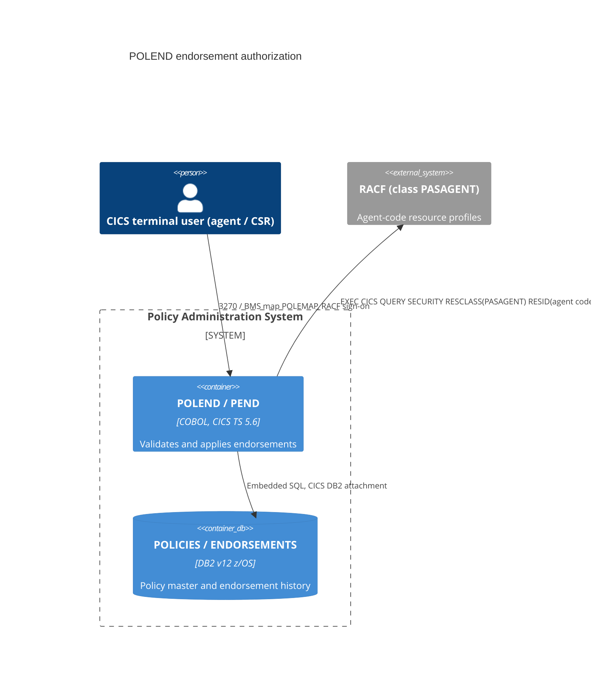

# 0001. Enforce endorsement type, cancel confirmation and agent authorization in POLEND (PEND)

- **Status:** Proposed
- **Date:** 2026-10-16
- **ARB ticket:** TO BE CREATED
- **Authors:** Devin (security remediation, code scan finding sfind-52b589ef69704909960079d479e8c373)
- **Owning team:** TBD — PAS mainframe team to confirm before ARB
- **Related ADRs:** none

## Context

`POLEND` (CICS transaction `PEND`) writes `ENDORSEMENTS` rows and updates `POLICIES.TOTAL_PREMIUM`.
A code scan found that:

- `WS-ENDORSEMENT-TYPE` was never populated (the BMS map `POLEMAP` was received into `POLICY-RECORD`,
  which has no endorsement-type field), and was only checked against `SPACES`, so uninitialised/garbage
  bytes were written as `ENDORSEMENT_TYPE`.
- The defined endorsement codes (`CAD`, `CRM`, `LCH`, `ACH`, `CAN`) were never enforced; `CAN`
  (cancellation) had no confirmation step.
- Nothing in the program tied the signed-on CICS user to the policy being endorsed; any caller able to run
  `PEND` could endorse any active policy by number.

ARB triggers: T6 (new in-program authorization check backed by a RACF resource class), T4 (input contract
of BMS map `POLEMAP` changes: policy number, endorsement type, cancel-confirm flag).

## Decision

We will receive `POLEMAP` into its BMS symbolic input map `POLEMAPI` (TIOA prefix plus L/F/I for
`PENUM` X(12), `PETYP` X(03), `PECNF` X(01)), hard-reject any endorsement type outside the 88-level set,
require the confirm flag = `Y` for `CAN`, and before any DB2 write call `EXEC CICS QUERY SECURITY` against
RACF resource class `PASAGENT` with the policy's `AGENT_CODE` as the resource, allowing the endorsement only
when the signed-on user holds UPDATE, and load the full policy record from DB2 so the audit trail and
confirmation map carry authoritative policy data. Every failure path fails closed (error screen, no DB2 write).

## Alternatives considered

| Alternative | Pros | Cons | Why rejected |
| --- | --- | --- | --- |
| Do nothing (rely on RACF transaction security for `PEND`) | No change | Any user permitted to run `PEND` can endorse/cancel any policy; garbage endorsement types persist | Leaves the finding open |
| Agent/user mapping table in DB2 checked by POLEND | Data-driven | New data store (T2), schema change gated by `check_schema.py`, new admin process | Heavier; duplicates RACF, which is already the system of record for CICS users |
| Carve endorsement type out of `POLICY-RECORD` FILLER | Keeps `RECEIVE INTO(POLICY-RECORD)` | Puts transaction input into the policy master layout used by downstream consumers | Wrong ownership of the field; still needs the map change |

## Architecture

## Non-functional requirements

| NFR | Target | How met |
| --- | --- | --- |
| Availability SLO | Unchanged from PEND today | No new component; RACF already in the path |
| p95 latency | TBD — owner to confirm before ARB | One extra in-memory RACF check per endorsement |
| RPO / RTO | Unchanged | No new data store |
| Peak load | Unchanged | Same transaction volume |
| Scaling model | Unchanged | Same CICS region(s) |
| Data retention | Unchanged | No new data |

## Security & compliance

- **Data classification:** Unchanged (existing policy data).
- **Encryption at rest:** Unchanged (DB2 z/OS).
- **Encryption in transit:** Unchanged.
- **AuthN / AuthZ:** AuthN unchanged (RACF sign-on). New AuthZ: UPDATE access to `PASAGENT.<agent code>` profile required per policy; missing agent code, RACF error or no UPDATE access all reject.
- **Secrets:** None.
- **Audit logging:** Existing TS queue audit trail unchanged; RACF logs access failures per class audit settings.
- **Data residency / regions:** Unchanged.
- **Policy sections satisfied:** N/A — no cloud infrastructure.
- **Threats considered:** Forged/garbage endorsement types, unconfirmed cancellations, cross-agent policy modification.

## Cost

| Item | Assumption | Monthly estimate |
| --- | --- | --- |
| RACF class/profile admin | Existing security admin process | TBD — owner to confirm |
| **Total** | No new infrastructure | ~0 |

## Operations

- **On-call rotation:** TBD — PAS mainframe team.
- **Runbook:** TBD — add PASAGENT profile administration to the PAS security runbook.
- **Dashboards / alarms:** RACF violation reports for class PASAGENT.
- **Rollback plan:** Redeploy previous POLEND load module and map (RTC).
- **Migration / cut-over plan:** (1) Define RACF class `PASAGENT` and per-agent profiles, permit agents/CSRs UPDATE; (2) assemble `POLEMAP` with TIOAPFX=YES and fields `PENUM` (12), `PETYP` (3), `PECNF` (1) in that order so the generated symbolic map matches `POLEMAPI`; (3) deploy POLEND. Deploying POLEND before steps 1-2 makes PEND reject all endorsements (fail closed).

## Policy exceptions requested

| Rule | Resource | Justification | Compensating control | Expiry |
| --- | --- | --- | --- | --- |
| none | | | | |

## Consequences

- Positive: Only valid, confirmed endorsements by entitled users reach DB2.
- Negative / risks: Requires coordinated RACF and BMS map changes; until done, PEND rejects endorsements.
- Follow-ups: Record the signed-on user in `ENDORSEMENTS.PROCESSED_BY` instead of `'POLEND'`.

## Open questions

- Is agent code the right entitlement key, or should CSRs be authorized by branch (`BRANCH_CODE`)?
- Confirm the RACF class name `PASAGENT` with mainframe security.
- p95 latency target and owning team.
