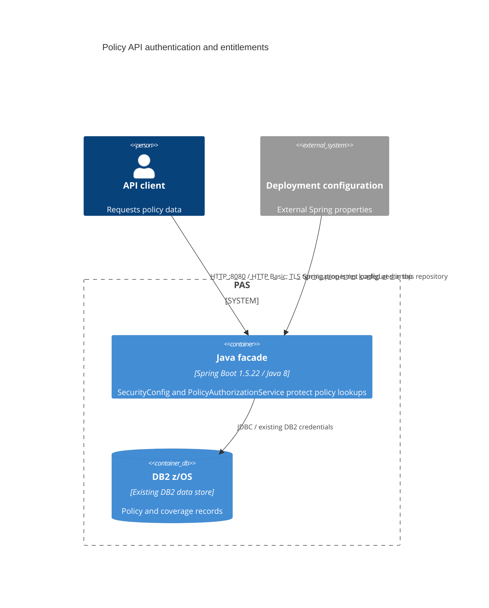

# 0001. Policy API Authentication and Entitlements

- **Status:** Proposed
- **Date:** 2026-10-16
- **ARB ticket:** TO BE CREATED
- **Authors:** TBD — PAS service owner to confirm
- **Owning team:** TBD — PAS service owner to confirm
- **Related ADRs:** None found in the repository

## Context

The read-only Java facade exposes policy lookups by sequential policy number.
Before this change, both policy and coverage lookups could be made without
authentication, allowing callers to enumerate records. The change adds API-only
HTTP Basic authentication and per-client agent/branch entitlements. A policy
outside a client's scope is returned as 404, and coverage data is fetched only
after the policy entitlement check. Boot's fallback security chain is disabled
so actuator, H2-console, Swagger, and other non-API paths retain their existing
behavior.

ARB trigger: **T6 — authentication/authorization boundary change** on `/api/**`.
Manual diff review and the heuristic detector both report `ARB_REQUIRED`
because T6 explicitly covers this change.

## Decision

We will require stateless HTTP Basic authentication for `/api/**`, load client
BCrypt hashes and entitlements from deployment-supplied Spring properties, and
authorize policy reads by unrestricted access or an agent/branch code match.
The production profile will not contain client credentials and the application
will fail at startup unless at least one valid client is configured.

## Alternatives considered

| Alternative | Pros | Cons | Why rejected |
| --- | --- | --- | --- |
| Do nothing | No code or deployment changes | Leaves policy enumeration unauthenticated | Does not address the identified exposure |
| Continue relying on network segmentation | No client credential lifecycle | Does not identify callers or enforce per-client policy scope | Network location alone does not meet the settled per-client authorization requirement |
| Integrate with a central OAuth2/OIDC identity provider | Centralized identity and credential lifecycle | Requires an identity-provider integration and client-registration work beyond this change's scope | Not selected for this change; revisit if a shared identity integration is adopted |

## Architecture

No new deployable service, data store, vendor, or external API is introduced.

## Non-functional requirements

| NFR | Target | How met |
| --- | --- | --- |
| Availability SLO | TBD — owner to confirm before rollout | Existing facade deployment; no availability target is recorded in the repository |
| p95 latency | TBD — owner to confirm before rollout | Authentication adds BCrypt verification; measure against the existing API workload |
| RPO / RTO | TBD — owner to confirm before rollout | Existing DB2 and deployment recovery arrangements are unchanged |
| Peak load | TBD — owner to confirm before rollout | Existing capacity; authentication overhead must be validated at expected peak |
| Scaling model | Existing facade deployment; details TBD | No new service or stateful session storage; API security sessions are stateless |
| Data retention | Existing DB2 retention; policy details TBD | No data-retention behavior changes |

## Security & compliance

- **Data classification:** Existing insurance policy data; formal classification
  is not identified in the repository and must be confirmed by the owner.
- **Encryption at rest:** Existing DB2 and deployment-configuration controls are
  unchanged; mechanisms are not documented here and must be confirmed.
- **Encryption in transit:** HTTP Basic must be protected by HTTPS. TLS
  termination and DB2 JDBC transport settings are not configured in this
  repository and must be verified in the deployment environment.
- **AuthN / AuthZ:** Stateless HTTP Basic on `/api/**`; BCrypt password hashes;
  unrestricted clients or agent/branch matches may read a policy. Unauthenticated
  API requests receive 401; out-of-scope policies receive 404.
- **Secrets:** Production client entries must be supplied through external
  configuration (for example, `SPRING_APPLICATION_JSON`). Local and test
  credentials are profile-scoped. The deployment secret-delivery mechanism is
  TBD.
- **Audit logging:** No new authentication or authorization audit events are
  added. Verify existing access logging and audit requirements before rollout.
- **Data residency / regions:** Existing DB2 and facade deployment are unchanged;
  region and residency requirements are not documented in the repository.
- **Policy sections satisfied:** No security-policy or approved-infrastructure
  file was found in the repository. Applicable organizational security controls
  must be confirmed during ARB review.
- **Threats considered:** Sequential policy enumeration is mitigated by
  authentication and concealed 404 responses. Basic credentials require TLS;
  incorrect entitlement configuration and the existing audit-logging posture
  remain deployment and operational risks.

## Cost

| Item | Assumption | Monthly estimate |
| --- | --- | --- |
| Existing facade runtime | No new service or data store; added authentication processing may affect existing capacity | TBD — owner to confirm |
| **Total** | Existing deployment only; no infrastructure sizing or pricing data is available here | TBD — owner to confirm |

## Operations

- **On-call rotation:** TBD — PAS service owner to confirm.
- **Runbook:** No runbook path is recorded in the repository; owner to provide one.
- **Dashboards / alarms:** Existing monitoring is unchanged; coverage for failed
  authentication and entitlement denials must be confirmed.
- **Rollback plan:** Revert to the previous application version if needed.
  Because rollback restores unauthenticated policy lookups, maintain compensating
  network restrictions and treat rollback as a security exception.
- **Migration / cut-over plan:** Provision approved production client usernames,
  BCrypt hashes, and entitlements through external configuration before startup.
  Verify API access and the unchanged non-API routes in the target environment.

## Policy exceptions requested

| Rule | Resource | Justification | Compensating control | Expiry |
| --- | --- | --- | --- | --- |
| none | | | | |

## Consequences

- Positive: Policy reads require an authenticated client with matching
  entitlements, and out-of-scope policy existence is concealed.
- Negative / risks: Production deployment must manage client configuration;
  Basic credentials require verified TLS, and operational targets and audit
  controls are not specified in the repository.
- Follow-ups: Create the ARB ticket, confirm TLS and security controls, and have
  the service owner set NFR targets and operational ownership.

## Open questions

- Which team owns the facade, on-call rotation, and runbook?
- What availability, latency, peak-load, recovery, and cost targets apply?
- Does the production deployment terminate TLS before port 8080, and is the DB2
  JDBC connection encrypted?
- What are the formal data-classification, residency, and authentication-audit
  requirements?
- What ARB ticket should be associated with this ADR?
