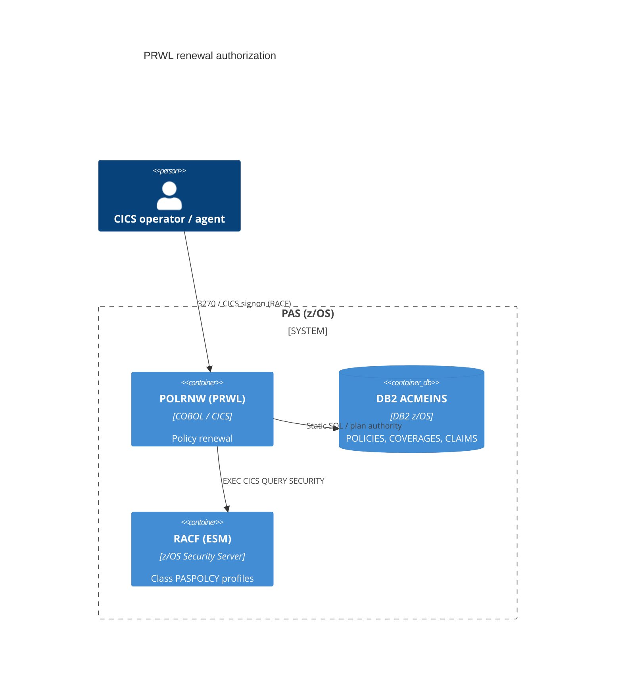

# 0001. RACF policy-authority check in POLRNW renewal (PRWL)

- **Status:** Proposed
- **Date:** 2026-10-16
- **ARB ticket:** TO BE CREATED
- **Authors:** Devin (security remediation)
- **Owning team:** Mainframe Team (mainframe-ops@acme.com)
- **Related ADRs:** none

## Context

CICS transaction PRWL (program POLRNW) renews whatever policy number is keyed on the
POLRMAP screen. RACF transaction security only controls who may start PRWL; nothing in the
program checks whether that user may act on the selected policy. Any PRWL user could rewrite
premium, term dates, `UW_STATUS` and `RENEWAL_COUNT` on any policy. The program also reads the
open-claims count and never checks it, so the ">3 open claims blocks renewal" rule has never
been enforced.

ARB triggers: T6 (authorization change: adds a per-policy authorization check to an
existing CICS transaction, backed by a new RACF general-resource class). No new service, data
store, vendor, infrastructure, or cost (T1-T5, T7-T9 not triggered).

## Decision

We will authorize each renewal against RACF before any update. POLRNW gets the signed-on user
(`EXEC CICS ASSIGN USERID`, fail closed if blank) and calls `EXEC CICS QUERY SECURITY` on class
`PASPOLCY`. The user needs UPDATE access to `PAS.AGENT.<agent_code>` or
`PAS.BRANCH.<branch_code>` for the policy's owning agent or branch as stored in DB2, or to
`PAS.UNASSIGNED` when the policy has no agent or branch. A denial shows the same message as a
missing policy. The POLICIES UPDATE re-checks agent/branch, so an ownership change between the
read and the update cannot slip through. More than 3 open claims blocks renewal.

## Alternatives considered

| Alternative | Pros | Cons | Why rejected |
| --- | --- | --- | --- |
| Do nothing | No change | Any PRWL user can renew or reset underwriting on any policy | Leaves the vulnerability open |
| New DB2 entitlement table (user to agent/branch) | Entitlements maintained with SQL | New data store (T2), DBA ownership, a second authority source next to RACF | RACF already holds user identity and access; a second store duplicates it |
| Trust agent/branch from the BMS map | No setup | The map is user-controlled | Not a security control |

## Architecture

## Non-functional requirements

| NFR | Target | How met |
| --- | --- | --- |
| Availability SLO | Unchanged | Calls run in-region inside CICS |
| p95 latency | Unchanged (TBD — owner to confirm) | One or two QUERY SECURITY calls per renewal |
| RPO / RTO | Unchanged | No new data |
| Peak load | Unchanged | Same transaction volume |
| Scaling model | Unchanged | N/A |
| Data retention | Unchanged | N/A |

## Security & compliance

- **Data classification:** Unchanged; no new data stored.
- **Encryption at rest:** N/A — no new storage.
- **Encryption in transit:** N/A — no new network flows.
- **AuthN / AuthZ:** CICS/RACF signon (unchanged) plus a new per-policy RACF check (class `PASPOLCY`).
- **Secrets:** None.
- **Audit logging:** RACF SMF records for QUERY SECURITY according to the class's audit settings (TBD — Security to confirm).
- **Data residency / regions:** Unchanged.
- **Policy sections satisfied:** Least privilege / object-level authorization.
- **Threats considered:** Renewing another agent's policy (IDOR); forged agent/branch on the map; ownership change between the read and the update; probing for policy numbers through error messages.

## Cost

| Item | Assumption | Monthly estimate |
| --- | --- | --- |
| RACF class and profiles | Existing ESM | $0 |
| **Total** | | $0 |

## Operations

- **On-call rotation:** Mainframe Team.
- **Runbook:** TBD — add RACF profile setup for `PASPOLCY` to the PRWL runbook.
- **Dashboards / alarms:** Watch for a spike in 'POLICY NOT FOUND FOR RENEWAL' after deployment.
- **Rollback plan:** Redeploy the previous POLRNW load module.
- **Migration / cut-over plan:** Before POLRNW is promoted, Security defines class `PASPOLCY` in
  the CDT and grants profiles: agent IDs get UPDATE on `PAS.AGENT.<code>`, branch staff get UPDATE
  on `PAS.BRANCH.<code>`, and central renewal staff get UPDATE on generic profile `PAS.**`. If the
  class is missing, every renewal is denied (fail closed).

## Policy exceptions requested

| Rule | Resource | Justification | Compensating control | Expiry |
| --- | --- | --- | --- | --- |
| none | | | | |

## Consequences

- Positive: Renewals are limited to the user's book of business, and the open-claims hold is enforced.
- Negative / risks: PRWL denies every renewal until the RACF profiles exist, so deployment depends on Security provisioning them first.
- Follow-ups: Apply the same model to POLEND, POLQRY and UNDWRT.

## Open questions

- Is class name `PASPOLCY` acceptable to RACF administration?
- Should renewal also preserve an approved `UW_STATUS` instead of resetting it to 'PN'? This PR keeps the existing reset to 'PN', which sends the new term back for re-underwriting.
