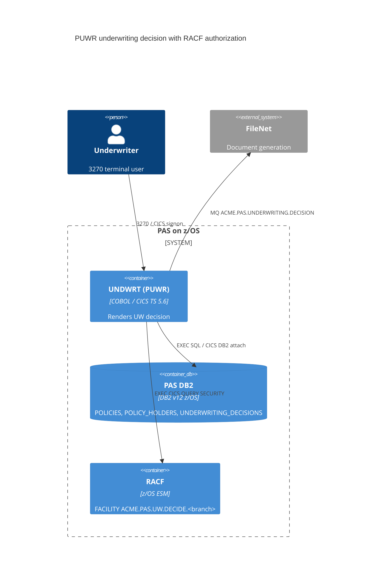

# 0001. RACF authorization for PUWR underwriting decisions

- **Status:** Proposed
- **Date:** 2026-10-16
- **ARB ticket:** TO BE CREATED
- **Authors:** Devin (code scan remediation)
- **Owning team:** Mainframe Team (mainframe-ops@acme.com)
- **Related ADRs:** none

## Context

CICS transaction `PUWR` (program `UNDWRT`) recomputes and persists an underwriting
decision for any policy number entered on the `UWRTMAP` map. Before this change it had no
in-program authorization: any user able to start `PUWR` could overwrite
`POLICIES.UW_STATUS` / `RISK_SCORE` for any policy, insert an `UNDERWRITING_DECISIONS`
row attributed to the literal `'SYSTEM'`, and write a `POLICY-RECORD` (mostly
caller-supplied map fields) to the TD/MQ queue `ACME.PAS.UNDERWRITING.DECISION`
consumed by FileNet document generation.

ARB triggers: T6 (authorization change — new RACF entitlement required to run PUWR decisions).

## Decision

We will require the signed-on CICS user to hold RACF `UPDATE` access to the
`FACILITY` profile `ACME.PAS.UW.DECIDE.<branch>` (branch = `POLICIES.BRANCH_CODE` of the
target policy) before UNDWRT renders, persists, or publishes a decision, checked with
`EXEC CICS QUERY SECURITY`; record the CICS `USERID` as `UNDERWRITER_ID`; and build the
MQ `POLICY-RECORD` only from DB2 data (map input is limited to the policy number).

## Alternatives considered

| Alternative | Pros | Cons | Why rejected |
| --- | --- | --- | --- |
| Do nothing (rely on transaction-level RACF on PUWR) | No change | Anyone allowed to start PUWR can re-decide any branch's policies; audit says `'SYSTEM'` | Leaves the finding open |
| New DB2 entitlement table (user → branch) | Data-driven | Schema change, new admin process, duplicates RACF | RACF already the system of record for mainframe access |
| Transaction-level check only (no branch scope) | Simpler profile setup | No restriction on which policies a user may touch | Does not scope access per policy |

## Architecture

## Non-functional requirements

| NFR | Target | How met |
| --- | --- | --- |
| Availability SLO | Unchanged (CICS region SLO) | No new component |
| p95 latency | TBD — owner to confirm before ARB | One extra in-memory RACF check per transaction |
| RPO / RTO | Unchanged | No new data store |
| Peak load | Unchanged | — |
| Scaling model | Unchanged | — |
| Data retention | Unchanged | — |

## Security & compliance

- **Data classification:** Unchanged (policy and policyholder data, including credit score).
- **Encryption at rest:** Unchanged.
- **Encryption in transit:** Unchanged.
- **AuthN / AuthZ:** CICS signon (existing) + new RACF `FACILITY` `UPDATE` check per branch; fails closed on any error, blank USERID, or blank branch.
- **Secrets:** None.
- **Audit logging:** `UNDERWRITING_DECISIONS.UNDERWRITER_ID` now holds the CICS USERID; RACF logs access per profile `AUDIT` settings.
- **Data residency / regions:** Unchanged.
- **Policy sections satisfied:** N/A — no cloud infrastructure.
- **Threats considered:** Unauthorized decision overwrite, cross-branch tampering, forged MQ payload fields, audit trail falsification.

## Cost

| Item | Assumption | Monthly estimate |
| --- | --- | --- |
| None | No new resources | $0 |
| **Total** | | $0 |

## Operations

- **On-call rotation:** Mainframe Team.
- **Runbook:** TBD — owner to confirm before ARB.
- **Dashboards / alarms:** RACF violation reports for `ACME.PAS.UW.DECIDE.*`.
- **Rollback plan:** Redeploy previous UNDWRT load module.
- **Migration / cut-over plan:** Security admin defines `FACILITY` profiles `ACME.PAS.UW.DECIDE.*` (or per-branch) and grants `UPDATE` to underwriter groups **before** deploying; otherwise PUWR decisions are denied (fail closed).

## Policy exceptions requested

| Rule | Resource | Justification | Compensating control | Expiry |
| --- | --- | --- | --- | --- |
| none | | | | |

## Consequences

- Positive: Only entitled underwriters can render decisions for their branches; audit trail names the user; MQ payload contains only DB2-sourced data.
- Negative / risks: Deploying before RACF profiles exist blocks all PUWR decisions.
- Follow-ups: Confirm the FileNet consumer's required fields if the MQ payload should be narrowed further.

## Open questions

- RACF profile naming and group mapping to be confirmed by the security admin team.
- p95 latency and runbook location (TBD by owner).
