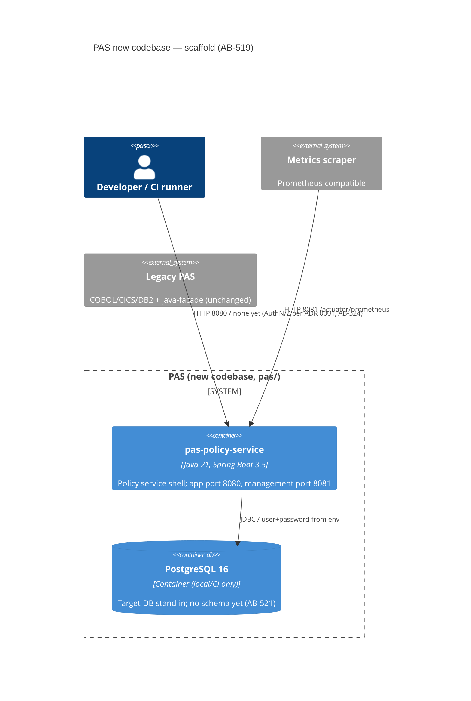

# 0002. PAS service scaffold, CI pipeline and local dev environment

- **Status:** Proposed
- **Date:** 2026-10-16
- **ARB ticket:** TO BE CREATED
- **Authors:** Devin (for the PAS modernization team)
- **Owning team:** PAS modernization (epic AB-516)
- **Related ADRs:** 0001 — PAS target architecture (AB-518, in progress). This ADR covers only the
  build/CI/local-dev scaffold (AB-519) and defers every target-architecture decision to 0001.

## Context

The legacy PAS is COBOL/CICS/DB2 plus a Java 8 / Spring Boot 1.5 read-only facade (`java-facade/`)
that is built by hand; there is no CI. Epic AB-516 moves PAS to Java, and every later ticket
(AB-520 harness, AB-521 data model, AB-522 rating, AB-523 batch, AB-524..526 APIs) needs a codebase,
a pipeline and a local environment to land in.

AB-518 (ADR 0001) is expected to settle service boundaries, target database, messaging, authN/Z and
the strangler approach. Its working direction, which this scaffold follows, is **one policy service**
(lifecycle, rating, underwriting) plus **Spring Batch jobs**, on Java 21 / Spring Boot 3, deployed as
containers.

ARB triggers: T1 (new deployable service `pas-policy-service`), T2 (PostgreSQL as the local/CI target
database), T7 (Java 21 / Spring Boot 3 introduced next to Java 8 / Boot 1.5), T8 (new shared library
`pas-observability`). The CI workflow itself grants no new permissions (`contents: read`).

## Decision

We will add a new Maven multi-module codebase under `pas/` (parent `pas-parent`, Java 21, Spring Boot
3.5.x) next to the legacy trees, with a shared `pas-observability` module and a `pas-policy-service`
application that has no business endpoints yet; later tickets add `pas-domain`, `pas-rating` and
`pas-batch` as sibling modules. Locally and in CI the service runs against PostgreSQL 16 via
`compose.yaml` and Testcontainers. Every PR runs a GitHub Actions `CI` workflow (build + unit and
integration tests, Spotless/SpotBugs, OSV-Scanner dependency scan, container image build and compose
smoke test), and `main` is protected with those four checks required. No message broker is added
until ADR 0001 picks one.

## Alternatives considered

| Alternative | Pros | Cons | Why rejected |
| --- | --- | --- | --- |
| Do nothing (keep building the facade by hand) | No work | No place for AB-520..530 to land; no automated tests, scans or images | Blocks the epic |
| Upgrade `java-facade/` in place to Boot 3 and grow it | One codebase | Facade is a read-only DB2 adapter slated for retirement (AB-524); in-place upgrade breaks the compat-gate baseline the migration is measured against | Keeps legacy coupling; retirement plan needs the old facade untouched |
| One Maven project per CICS transaction / microservice | Independent deployables | Contradicts the one-policy-service direction in AB-518; multiplies pipelines before boundaries are agreed | Premature split |
| Gradle instead of Maven | Faster incremental builds | Org and the existing facade/compat tooling (`compat/build_modules.sh`) are Maven | Consistency |
| Trivy / OWASP Dependency-Check for the dependency scan | Mature | Dependency-Check needs an NVD API key and is slow; Trivy action had tag-hijack concerns | OSV-Scanner is keyless, fast and resolves Maven transitives |

## Architecture

The legacy system is not called by the scaffold; it is shown only to make clear nothing changes there.

## Non-functional requirements

| NFR | Target | How met |
| --- | --- | --- |
| Availability SLO | TBD — owner to confirm before ARB (set in ADR 0001) | Liveness/readiness probes; readiness includes DB |
| p95 latency | TBD — no business endpoints yet | Micrometer HTTP server metrics exported |
| RPO / RTO | N/A — no business data stored by this change | — |
| Peak load | N/A — no business endpoints yet | — |
| Scaling model | Stateless container, horizontal | Graceful shutdown, externalised config |
| Data retention | N/A — local/CI PostgreSQL holds no business data | Compose volume removed by `make down` |

## Security & compliance

- **Data classification:** none stored by this change; POLICY_HOLDERS PII handling is AB-521.
- **Encryption at rest:** N/A for local/CI containers; production target DB per ADR 0001.
- **Encryption in transit:** N/A locally; production TLS per ADR 0001.
- **AuthN / AuthZ:** no business endpoints are exposed. Actuator is on a separate management port and
  exposes only `health`, `info`, `prometheus`; health details are hidden. API authN/Z is AB-524.
- **Secrets:** DB credentials come from `PAS_DB_*` env vars; no defaults for passwords in application
  config; nothing baked into the image. The compose password is a local-only default.
- **Audit logging:** structured ECS JSON logs with a validated `X-Correlation-Id` in MDC.
- **Data residency / regions:** N/A.
- **Policy sections satisfied:** compat gate security checks (no exposed actuator, no hardcoded
  secrets); container runs as non-root.
- **Threats considered:** log injection via correlation header (validated, replaced if invalid);
  vulnerable dependencies (OSV-Scanner on every PR); unpinned CI actions (third-party actions pinned
  to commit SHAs).

## Cost

| Item | Assumption | Monthly estimate |
| --- | --- | --- |
| GitHub Actions minutes | Public repo, standard runners | $0 |
| **Total** | No new recurring infrastructure | $0 |

## Operations

- **On-call rotation:** TBD — owner to confirm before ARB (no production deployment in this change).
- **Runbook:** `README.md` → "Getting started (new codebase)".
- **Dashboards / alarms:** `/actuator/prometheus` is scrape-ready; dashboards come with deployment.
- **Rollback plan:** revert the PR; legacy trees and the compat gate are untouched.
- **Migration / cut-over plan:** N/A — governed by AB-529/AB-530.

## Policy exceptions requested

| Rule | Resource | Justification | Compensating control | Expiry |
| --- | --- | --- | --- | --- |
| none | | | | |

## Consequences

- Positive: every later AB-516 ticket has a module layout, a green pipeline and `make dev`.
- Negative / risks: the PostgreSQL and "no broker" choices are provisional until ADR 0001 is accepted;
  if 0001 picks a different database, `compose.yaml`, the JDBC driver and the integration test change.
- Follow-ups: add `pas-domain` (AB-521), `pas-rating` (AB-522), `pas-batch` (AB-523); add the broker
  to `compose.yaml` once 0001 decides; repo admin applies `.github/scripts/protect-main.sh`.

## Open questions

- Target database and broker (ADR 0001 / AB-518).
- Availability SLO and on-call owner for `pas-policy-service`.
- Container registry and deployment platform for image publishing (CI currently builds but does not push).
