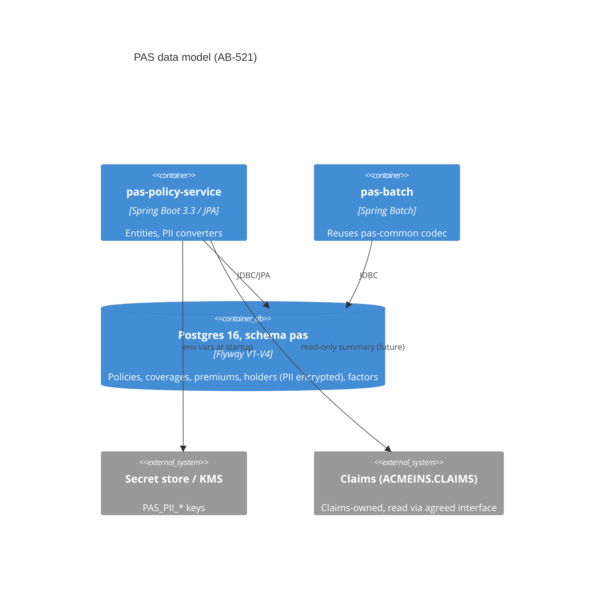

# ADR 0002: PAS target data model, copybook codec and PII field encryption

- **Status:** Proposed
- **Ticket:** AB-521 (epic AB-516)
- **ARB:** Pending: ARB (triage done by hand from the `arb-triggers` rule: T2 hits, so
  `ARB_REQUIRED`; ticket id to be raised by the coordinator, no Jira writes from this session)
- **Security:** Pending: security

## Context

PAS data lives in DB2 schema `ACMEINS`, and batch/CICS programs exchange fixed-width records
defined by copybooks (COMP-3 packed decimals, YYYYMMDD dates, 88-level codes). The Java platform
(AB-519) has an empty Flyway-managed Postgres schema `pas`. `POLICY_HOLDERS` holds regulated data
(DOB, SSN last 4, tax ID, credit score) that is plaintext in DB2.

## Decision

1. **Schema:** Flyway migrations V2–V4 in `pas-policy-service` port every ACMEINS table into `pas`
   with the same column names, types (DECIMAL→NUMERIC, TIMESTAMP→TIMESTAMP(6)), keys, foreign keys,
   indexes and defaults, plus `pas.policy_seq` (INTEGER, start 1000000, increment 1, no max, no
   cycle, cache 50). Hibernate runs with `ddl-auto=validate`; Flyway owns all DDL.
   One intentional key change: `underwriting_decisions` has a surrogate `decision_id` identity PK
   and a non-unique `(policy_number, decision_date)` index, so same-day decisions are no longer
   lost (quirk register [Q-20](../modernization/quirk-register.md#q-20), Fix; Proposed — pending
   PO sign-off).
2. **Reference data:** `territory_factors` and new `class_factors` keyed by
   `(factor_set, code, effective_date)`; `PARITY` set seeded with a 1.0000 catch-all, `FILED` set
   empty. `pas.rating.factor-set` (default `PARITY`) selects the set (AB-522).
3. **Copybooks:** `pas-common` gets a dependency-free codec (`RecordLayout`, `PackedDecimal`,
   `ZonedDecimal`) and value types/enums for the four copybooks; JPA entities live in
   `pas-policy-service` `persistence`. Raw codes are kept; enums resolve them.
4. **PII:** application-level AES-256-GCM via JPA converters, HMAC-SHA256 blind indexes for lookup,
   keys from environment/secret (`PAS_PII_ENCRYPTION_KEY`, `PAS_PII_BLIND_INDEX_KEY`), redacted
   `toString`, log test. Details in `docs/modernization/pii-handling.md`.
5. **Claims:** no claims table or FK in `pas`; read via an agreed interface
   (`docs/modernization/claims-interface-assumptions.md`).

## Alternatives considered

- **Postgres `pgcrypto` / TDE only:** keys would reach the database server and plaintext would show
  in SQL logs; disk encryption alone does not protect backups or DBA access. Rejected for the four
  regulated fields (still expected as a base layer).
- **Hibernate `ddl-auto=update`:** non-reviewable DDL, conflicts with the compat gate. Rejected.
- **Renaming tables/columns to a new domain model:** breaks 1:1 reconciliation with DB2 during
  parallel run. Deferred until after cutover.
- **Separate tables per factor set:** more tables and duplicated queries; a `factor_set` column
  keeps the DB2 key per set and lets AB-522 switch sets by config.

## Context diagram

## Non-functional requirements

- **Data classification:** `policy_holders` is Confidential/Regulated PII; other tables Confidential.
- **Availability / RPO / RTO:** inherited from the platform Postgres (AB-519); unchanged here.
- **Load:** ~1 extra AES-GCM operation per PII field read/write; negligible next to DB I/O.

## Security and compliance

Data flows, encryption, key handling, logging and masking: `pii-handling.md`. No new network
boundary, endpoint, or authn/z change. No secrets are committed; the compat security check passes.

## Cost and ownership

No new infrastructure or vendor; no recurring cost. Owner: PAS platform team. Runbook entry for key
rotation to be written once security picks the KMS.
