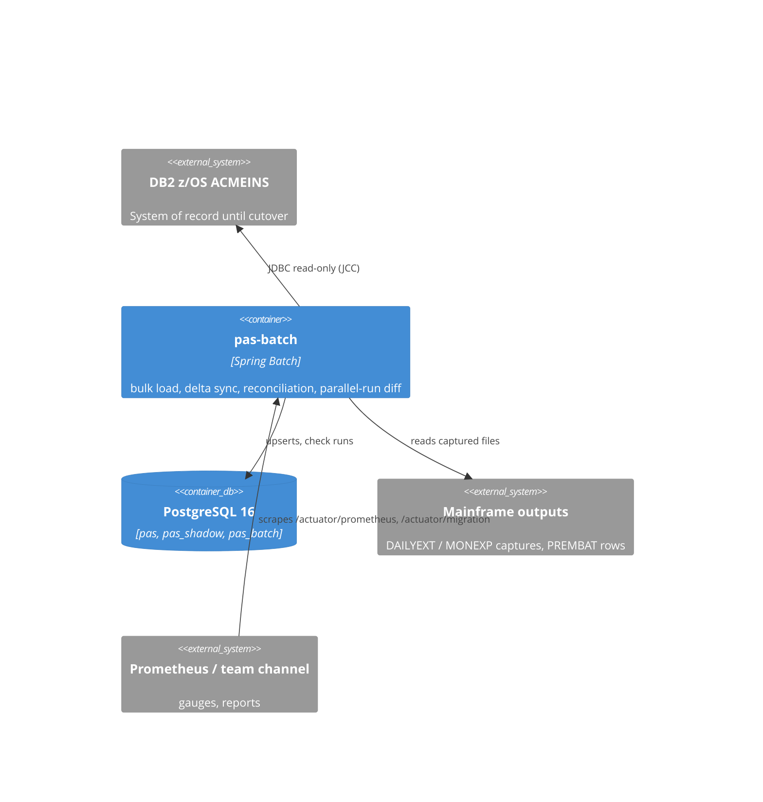

# ADR 0003: DB2 → PostgreSQL migration, delta sync, reconciliation and parallel run

- **Status:** Proposed
- **Date:** 2026-10-20
- **ARB ticket:** TO BE CREATED (Pending: ARB — no Jira writes from this session)
- **Authors:** AB-529 (epic AB-516)
- **Owning team:** PAS modernization (pas-batch); Mainframe team for the DB2 side
- **Related ADRs:** [0001](0001-pas-target-architecture.md) D8 (CDC, `pas_shadow`, rollback), [0002](0002-pas-target-data-model-and-pii.md) (target model, PII)

ARB triage (by hand from the `arb-triggers` rule; the plugin script is blocked by guardrails):
T1 (new scheduled jobs in `pas-batch`), T2 (new `pas` tables and schema `pas_shadow`; PII stays
encrypted as in ADR 0002), T4 (new DB2 → PostgreSQL sync contract), T8 (spans Mainframe, Platform
and Ops) → **ARB_REQUIRED**. No new deployable, vendor, infrastructure or auth boundary.

## Context

ADR 0001 D8 decided a bulk load plus one-way CDC (timestamp fallback), DB2 as system of record until
AB-529 sign-off, `pas_shadow` for parallel-run output and reverse replication in the rollback window.
AB-529 implements the parts that do not need the mainframe team and proves them locally. No real DB2
is reachable.

## Decision

- Run the migration inside the existing `pas-batch` deployable (package `batch.migration`, off unless
  `pas.migration.enabled=true`): `db2BulkLoadJob`, `db2DeltaSyncJob`, `migrationReconciliationJob`,
  `parallelRunDiffJob`, plus a CLI profile (`pas.migration.cli`). No `pas-migration` service.
- Read DB2 through a separate read-only Hikari pool (not a Spring `DataSource` bean) with the IBM JCC
  driver; write `pas.*` through idempotent upserts in chunk transactions; encrypt holder PII with the
  ADR 0002 cipher/blind index before it reaches PostgreSQL.
- Ongoing sync: timestamp/watermark deltas (`pas.migration_watermarks`) now; **log-based CDC (IBM IIDR
  or Debezium Db2) recommended for production**, pending the mainframe team. A pause switch
  (`pas.migration_sync_control`) supports rollback.
- Reconciliation and parallel-run diff with one triage register; results in files, `pas.migration_check_runs`,
  `/actuator/migration` and Prometheus gauges. Flyway V6 in `pas-policy-service` owns the new tables
  and `pas_shadow.premiums` (no FKs, `shadow_run_id`, `cdc_position`).

## Alternatives considered

| Alternative | Why not |
| --- | --- |
| New `pas-migration` deployable | ADR 0001 caps the platform at one service + one batch app; the jobs reuse pas-batch scheduling, metadata and alerting. |
| CDC only, no timestamp fallback | Blocks all progress on the mainframe team; fallback also serves local/CI. |
| Spring Batch `JdbcCursorItemReader` / DB2 UNLOAD files | Paging by primary key is restartable and portable to the H2/PostgreSQL stand-ins; UNLOAD needs mainframe jobs. |
| Compare by full-row SQL `EXCEPT` across databases | Impossible across DB2 and PostgreSQL; canonical hashes work on both. |

## Architecture

## Non-functional requirements

- Availability: batch only; a missed run is caught by the next delta (watermark + overlap).
- RPO for the sync: one delta interval (15 min) on the fallback; seconds with CDC.
- Data classification: Confidential + PII (POLICY_HOLDERS); PII only as ciphertext/blind index.
- Load: full book bulk load chunked (default 500 rows); reconciliation holds key→hash maps in memory
  (≈100 bytes per row; partition by key range if the book outgrows the heap).

## Security & compliance

Read-only DB2 user from the secrets store (`PAS_MIGRATION_SOURCE_*`); PII keys shared with
pas-policy-service (`PAS_PII_*`); reports and `/actuator/migration` carry keys and canonical values of
POLICIES/COVERAGES/PREMIUMS (no holder PII); `pas-batch` actuator exposure follows the AB-519 network
policy (internal only). Pending: Security.

## Cost

No new infrastructure. DB2 MIPS for deltas and daily reconciliation reads (estimate Pending: Mainframe
team); CDC licensing if IIDR is chosen.

## Operations

Runbook: [data-migration.md](../modernization/data-migration.md), [parallel-run.md](../modernization/parallel-run.md).
On-call: PAS platform team; triage owner named for the parallel-run cycle (Pending: Ops).

## Policy exceptions requested

N/A — no infrastructure outside the approved policy.

## Consequences

The fallback misses deletes and updates that do not move a change column; the daily reconciliation
detects them, and a bulk-load re-run repairs them. `pas_shadow` is dropped by AB-530 after cutover.

## Open questions

See `open-questions.md` § AB-529: CDC product, billing-cycle run, AB-523 shadow mode, production
rollback rehearsal and window, report publishing, POLICY_SEQ at cutover.
