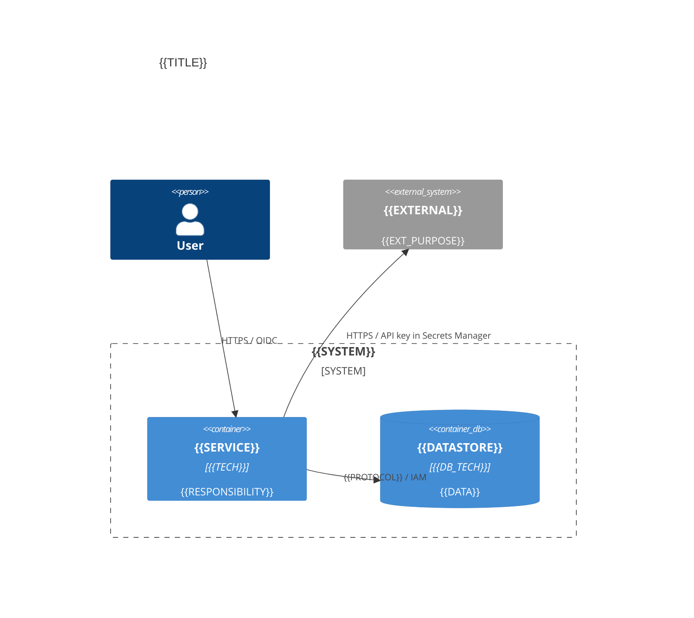

# {{NUMBER}}. {{TITLE}}

- **Status:** Proposed
- **Date:** {{DATE}}
- **ARB ticket:** {{TICKET}}
- **Authors:** {{AUTHORS}}
- **Owning team:** {{TEAM}}
- **Related ADRs:** {{RELATED}}

## Context

{{CONTEXT}}

ARB triggers: {{TRIGGERS}}

## Decision

We will {{DECISION}}

## Alternatives considered

| Alternative | Pros | Cons | Why rejected |
| --- | --- | --- | --- |
| Do nothing | | | |
| {{ALT_1}} | | | |
| {{ALT_2}} | | | |

## Architecture

## Non-functional requirements

| NFR | Target | How met |
| --- | --- | --- |
| Availability SLO | | |
| p95 latency | | |
| RPO / RTO | | |
| Peak load | | |
| Scaling model | | |
| Data retention | | |

## Security & compliance

- **Data classification:**
- **Encryption at rest:** (KMS CMK ids/aliases)
- **Encryption in transit:**
- **AuthN / AuthZ:**
- **Secrets:**
- **Audit logging:**
- **Data residency / regions:**
- **Policy sections satisfied:**
- **Threats considered:**

## Cost

| Item | Assumption | Monthly estimate |
| --- | --- | --- |
| | | |
| **Total** | | |

## Operations

- **On-call rotation:**
- **Runbook:**
- **Dashboards / alarms:**
- **Rollback plan:**
- **Migration / cut-over plan:**

## Policy exceptions requested

| Rule | Resource | Justification | Compensating control | Expiry |
| --- | --- | --- | --- | --- |
| none | | | | |

## Consequences

- Positive:
- Negative / risks:
- Follow-ups:

## Open questions

- 
