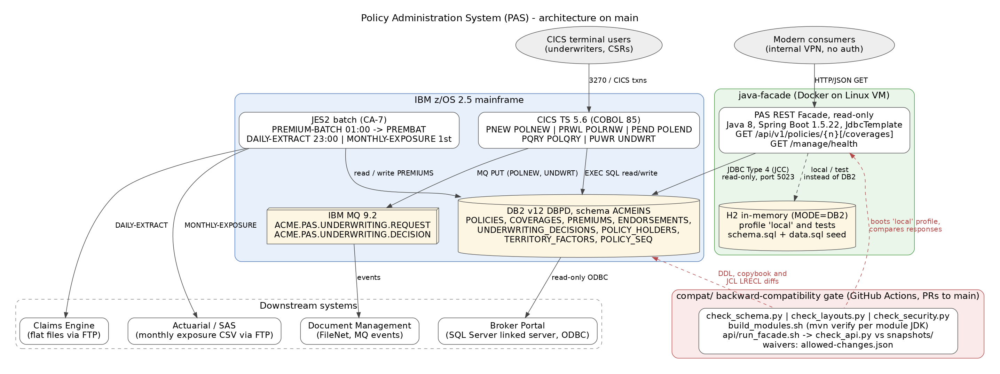

# PAS architecture

How the Policy Administration System (PAS) is put together on `main`: the COBOL/CICS/DB2 core on z/OS, the read-only Java REST facade, its H2 local-dev profile, and the `compat/` backward-compatibility gate that guards every PR during the modernization (epic AB-516).



The diagram source is [`diagrams/architecture.dot`](diagrams/architecture.dot) (Graphviz). After editing it, run `docs/diagrams/render.sh` to regenerate [`architecture.png`](diagrams/architecture.png) and [`architecture.svg`](diagrams/architecture.svg) (needs `graphviz`).

## Components

| Component | Where | What it does |
|---|---|---|
| CICS online programs | `cobol/programs/` | COBOL 85 under CICS TS 5.6. `POLNEW` (PNEW), `POLRNW` (PRWL), `POLEND` (PEND), `POLQRY` (PQRY, read-only), `UNDWRT` (PUWR). All policy writes happen here. |
| Batch | `jcl/`, `cobol/programs/PREMBAT.cbl` | JES2 jobs scheduled by CA-7: `PREMIUM-BATCH` (daily 01:00, runs `PREMBAT`), `DAILY-EXTRACT` (daily 23:00), `MONTHLY-EXPOSURE` (1st of month, 02:00). |
| Record layouts | `cobol/copybooks/` | `POLICY-RECORD`, `COVERAGE-RECORD`, `CUSTOMER-RECORD`, `PREMIUM-RECORD`, shared by the programs and read byte-for-byte by downstream consumers. |
| DB2 v12 | `sql/ddl/create-tables.sql` | Subsystem `DBPD`, schema `ACMEINS`: `POLICIES`, `COVERAGES`, `PREMIUMS`, `ENDORSEMENTS`, `UNDERWRITING_DECISIONS`, `POLICY_HOLDERS`, `TERRITORY_FACTORS`, sequence `POLICY_SEQ`. |
| IBM MQ 9.2 | `POLNEW.cbl`, `UNDWRT.cbl` | `POLNEW` puts underwriting referrals on `ACME.PAS.UNDERWRITING.REQUEST`; `UNDWRT` puts decisions on `ACME.PAS.UNDERWRITING.DECISION`. |
| REST facade | `java-facade/` | Java 8, Spring Boot 1.5.22, `JdbcTemplate` (no JPA). Read-only `GET /api/v1/policies/{policyNumber}` and `/coverages`, plus actuator health at `/manage/health`. No authentication. Runs as a Docker container on a Linux VM and reaches DB2 over JDBC Type 4 (`mainframe.acme.local:5023`). |
| H2 local profile | `java-facade/src/main/resources/application-local.properties`, `schema.sql`, `data.sql` | `--spring.profiles.active=local` swaps DB2 for an in-memory H2 database in DB2 mode, seeded with policies `POL-00000001`..`POL-00000003`, and enables the H2 console at `/h2-console`. The tests use the same H2 setup (`src/test/resources/application.properties`). The default profile keeps `spring.datasource.initialize=false`, so nothing is seeded into DB2. |
| Compatibility gate | `compat/`, `.github/workflows/compat-gate.yml`, `Makefile` | Runs on every PR to `main`; see below. |

## Data flows

- **Online writes:** CICS terminal -> CICS transaction -> DB2 (and MQ for new business and underwriting).
- **Reads for modern systems:** HTTP client -> facade -> DB2 (read-only). In local dev and CI the facade reads H2 instead.
- **Premium recalculation:** `PREMIUM-BATCH` runs `PREMBAT`, which reads `POLICIES`/`TERRITORY_FACTORS` and inserts into `PREMIUMS`; it writes a 132-byte report.
- **Claims and Broker Portal:** `DAILY-EXTRACT` unloads policy (LRECL 200) and coverage (LRECL 150) files and sends them to `CLAIMSRV.ACME.LOCAL` with plaintext FTP. Broker Portal reads DB2 through a SQL Server linked server (ODBC).
- **Actuarial:** `MONTHLY-EXPOSURE` writes an LRECL 300 exposure file and sends it by FTP to `ACTUARIAL.ACME.LOCAL` for the SAS models.
- **Documents:** MQ events drive document creation in FileNet.

## Backward-compatibility gate (`compat/`)

The GitHub Actions workflow `PAS backward-compatibility gate` runs three jobs on each PR to `main` (details in [`compat/README.md`](../compat/README.md)):

| Job | Script | Fails on |
|---|---|---|
| Schema, layouts & security | `check_schema.py`, `check_layouts.py`, `check_security.py` | Dropped/narrowed DB columns or tables, `POLICY_SEQ` changes, edited Flyway migrations; copybook offset/length or JCL LRECL changes; added secrets, exposed actuator, H2 console outside the local profile, plaintext FTP |
| Build & tests | `build_modules.sh` | `mvn verify` failure in any Maven module, built with the JDK its POM declares (JDK 8 for the facade) |
| REST API contract | `api/run_facade.sh` -> `api/check_api.py` | Responses of the facade (started on the `local` H2 profile) that differ from `api/snapshots/policies-v1.json` in status, removed fields, or types/values |

Deliberate changes are waived by adding the printed finding id to `compat/allowed-changes.json` with a ticket and reason.

## Running it locally

```bash
make compat                      # all gate checks (JDK 8 + Python 3)
cd java-facade && mvn verify     # build + 6 tests on H2
java -jar target/pas-facade-1.0.0.jar --spring.profiles.active=local   # keep running; curl from a second terminal
curl localhost:8080/api/v1/policies/POL-00000001
curl localhost:8080/api/v1/policies/POL-00000001/coverages
curl localhost:8080/manage/health
```

The COBOL, JCL and DB2 DDL have no local build or runtime in this repository; they are compiled and deployed on z/OS outside it.
